<div align="center">
  <picture>
    <source media="(prefers-color-scheme: dark)" srcset="docs/media/ariane-wordmark-light.png">
    
  </picture>
  <p><strong>Keep the human thread.</strong></p>
  <p>A writing desk for your manuscript and everything that helps you write it.</p>
  <p>Interface: English · Français · Español</p>
  <p><a href="#how-ariane-fits-into-your-work">Discover ariane</a> · <a href="#a-page-designed-for-reading-and-writing">Explore the design</a> · <a href="#see-ariane-in-action">Watch the film</a> · <a href="#try-ariane">Try ariane</a></p>
</div>

**ariane is a local writing app for macOS, built for manuscripts that grow alongside notes and research.** Write a novel, develop an essay or work through a documented narrative. Shape chapters and scenes, consult a source beside the sentence, compare drafts and pick up where you left off, in the same writing space.

The page stays at the centre. The structure, notes and tools are there when you need them; your words remain yours to write and revise. **No account or cloud service is required to write.**

[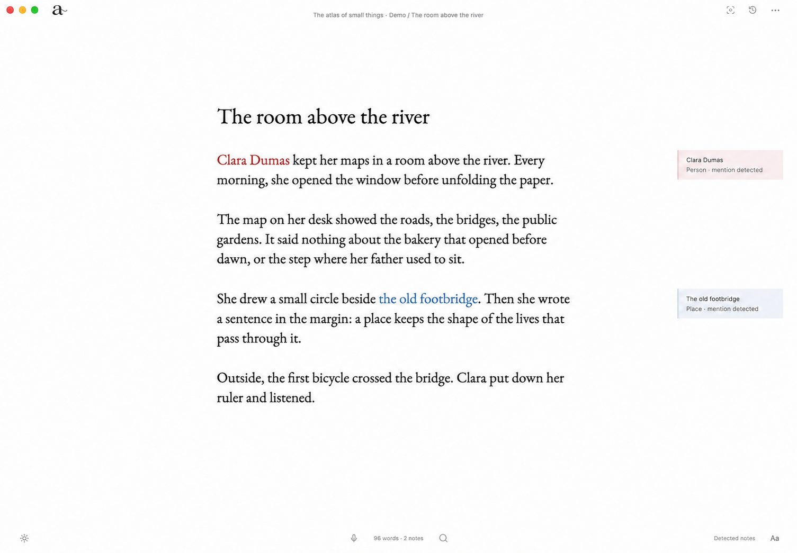](docs/media/0.3.2/edited/writing.png)

_The screenshots come from the experimental ariane 0.3.2 on macOS, using the fictional project The atlas of small things. Window controls and cursors were retouched for presentation; [see the capture notes](docs/media/0.3.2/README.md)._ [Try the current version](#try-ariane).

## How ariane fits into your work

A long text carries more than its paragraphs: a character’s earlier name, the note behind a claim, a scene you moved yesterday, a sentence that worked better in the first draft. ariane gives these things a place around the manuscript.

1. **Start a project and write.** Keep chapters, scenes and working texts in the binder, then close it when you want more room on the page.
2. **Bring in context when you need it.** Connect a read-only Obsidian vault or create notes owned by the project. Open a note beside your text, follow its linked passages or insert a reference.
3. **Return to your work.** The resume panel brings back your working context and recent note activity. Search, annotations and the outliner help you find and shape what matters.
4. **Revisit and share the manuscript.** Compare versions, recover a passage and export the whole manuscript or the current section.

You can also use ariane simply to write. Research connections and local AI modules are optional; your manuscript stays on your Mac.

## A page designed for reading and writing

The writing surface takes its cues from a printed page: a literary title, a measured text column and generous margins. **EB Garamond** gives the manuscript its book-like texture; **Figtree** and **Source Code Pro** offer sans-serif and monospace alternatives. Adjust the type size, column width and line spacing to make the page comfortable for you. Notes and controls emerge around the text, leaving the manuscript as the visual anchor.

The small controls have specific jobs:

- The **binder** holds the structure and can close to give the page more room. Its opening handle follows the pointer along the left edge.
- **Source notes sit in the margin**, beside the text they relate to. A mention opens a contextual card; the full reader is there when you want to look further.
- The **word count opens into a counter and Pomodoro timer**. Writing and reading controls gather under **Aa**, including typography, focus and scrolling.
- A **single status capsule at the top** carries save states, note activity, indexing and errors. Details and available actions open from there.
- **Light, dark and system themes** carry through the writing surface and its panels. Interface language is available in English, French and Spanish, independently of the manuscript’s language.

Short transitions accompany panels as they open and close, and follow the system’s reduced-motion preference. The immersive focus mode clears the surrounding tools when you want to stay with the page.

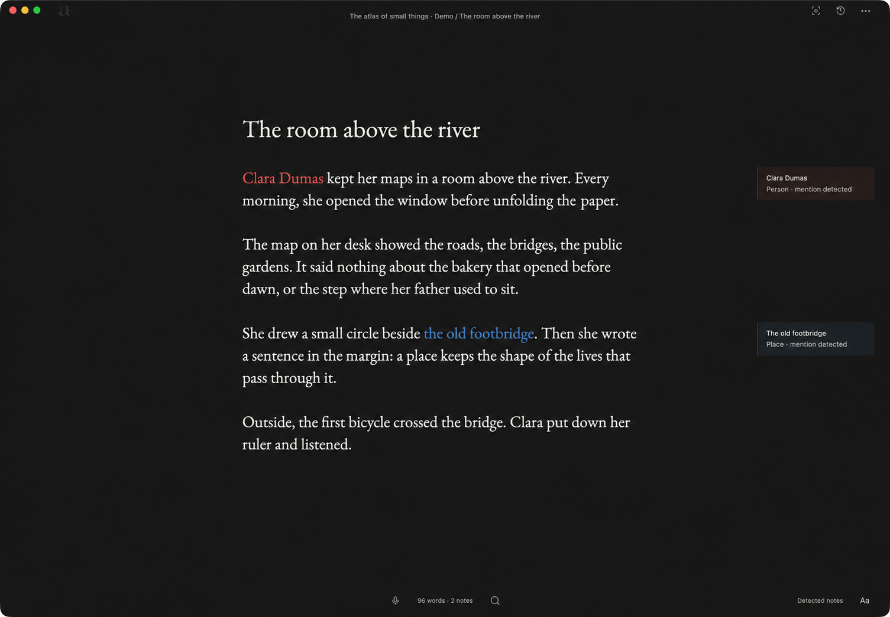

<details>
<summary>See the writing and reading controls</summary>

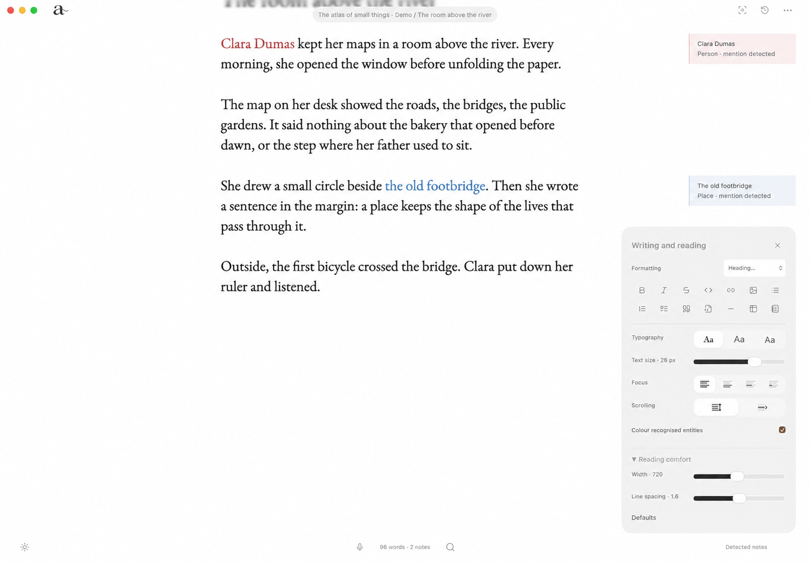

</details>

## Research that meets you in the sentence

Write a person’s name or a place into a scene. With the local entity module installed, ariane can recognize it, give it a color by type and create an entry in the project’s vault. Existing research notes can appear alongside the passage. Open the card to inspect its details and the places where it appears in your manuscript.

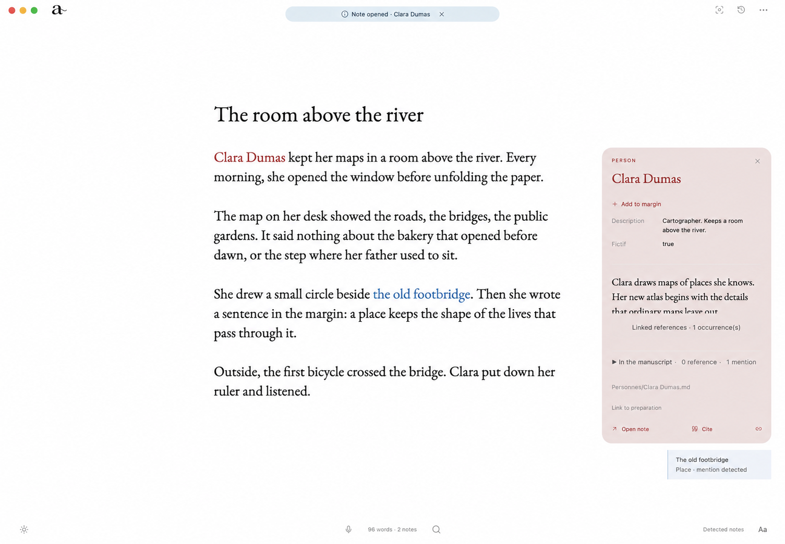

<details>
<summary>See a note open beside the manuscript</summary>

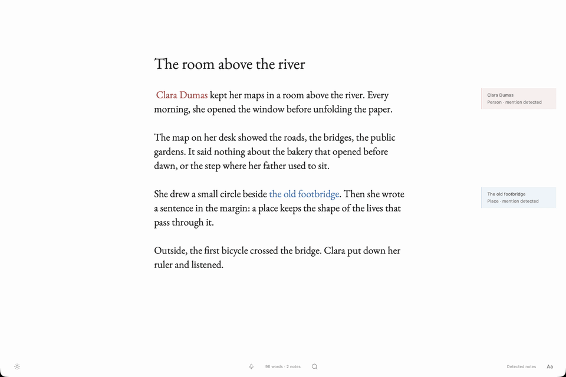

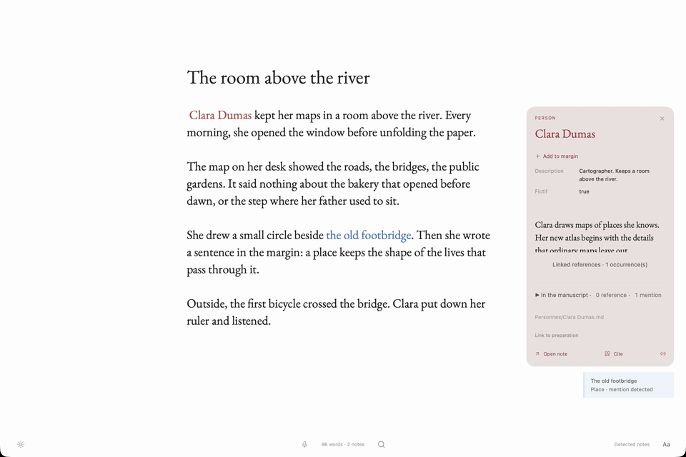

</details>

Connect an existing **Obsidian vault in read-only mode**, or keep new notes in a vault owned by the project. External notes stay in their original files. Add aliases to a project entry so a former name or pseudonym points to the same person; when a name is ambiguous, choose the relevant entry or confirm a separate one.

The **source-depth control** broadens the research around a passage: detected notes, direct links, shared themes and more distant connections. Local semantic retrieval can suggest notes with related meaning and recall earlier manuscript passages. Each suggestion leads back to its source so you can assess it. A matching name or a semantic connection does not establish a fact.

Use annotations for your own questions and reminders. They stay attached to a selected passage, separate from the manuscript and its exports. When a source belongs in the text, insert a citation or reference at the cursor.

<details>
<summary>Read the source beside your manuscript</summary>

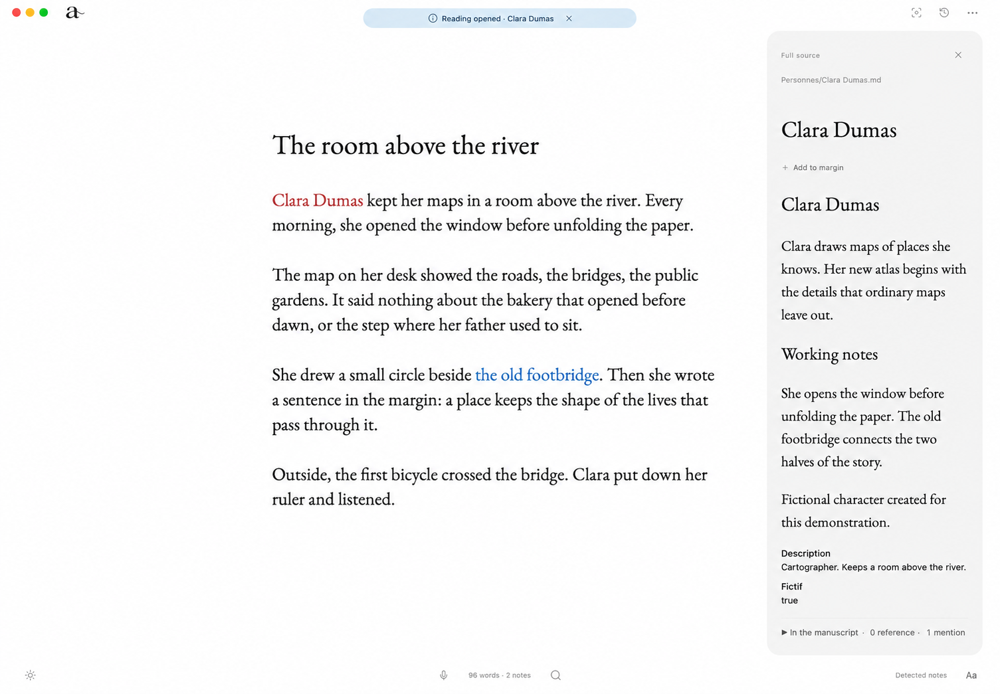

</details>

## Pick up the thread of your work

The resume button in the upper-right corner opens your last working passage, the previous passage and the last source consulted when that context is available. A local activity journal records detected, suggested, opened and created notes, along with actions such as classification, association, citation, pinning and editing. Reopen a note directly from its entry.

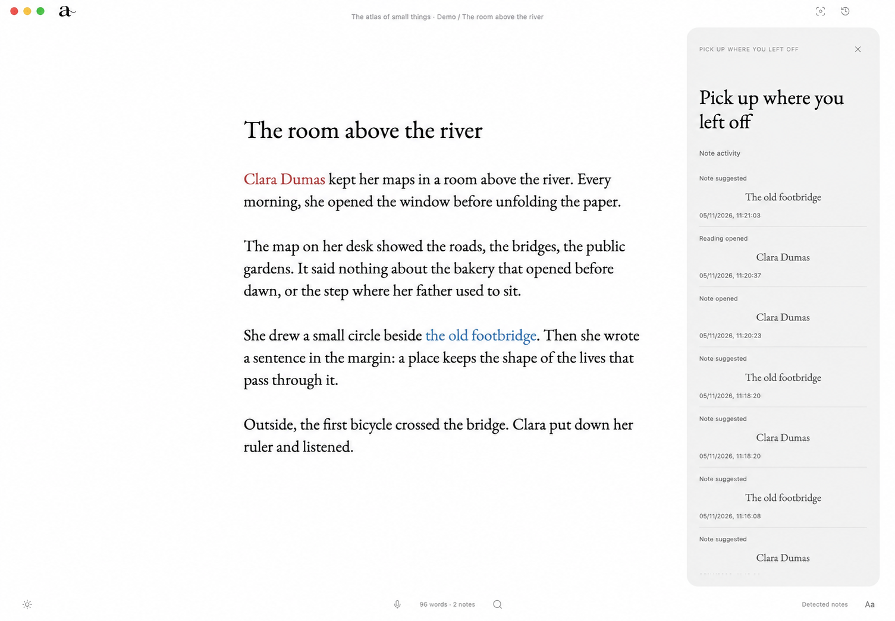

<details>
<summary>See the resume panel open</summary>


</details>

New activity appears briefly in the top capsule while you work. The journal keeps the dated entries for later; opening it does not replay old notifications. It starts with activity observed by the updated app and does not reconstruct earlier actions.

## From an idea to a manuscript

Keep chapters, scenes and working texts in the binder. Reorder them, choose which texts belong in the manuscript and read the included scenes continuously. Import Markdown, plain text, Word or TextBundle material into the open project as it grows.

Inside a page, the **outliner** works at the scale of an idea. Nest a passage beneath another, move its whole branch and fold it away. Drag above, below or inside a line, or use Tab, Shift+Tab and Option+↑/↓ from the keyboard. The hierarchy is saved with the text.

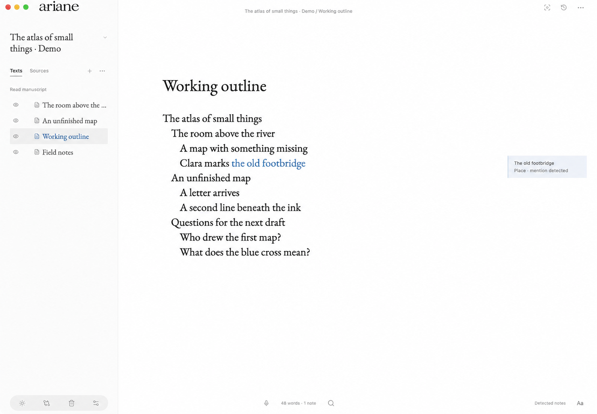

**Live Markdown** renders headings, emphasis and tables as you write. Table cells remain editable in place. Search within the open text, or find vault notes by wording and meaning, with priority given to exact titles and unambiguous aliases.

<details>
<summary>Editable tables and contextual search</summary>

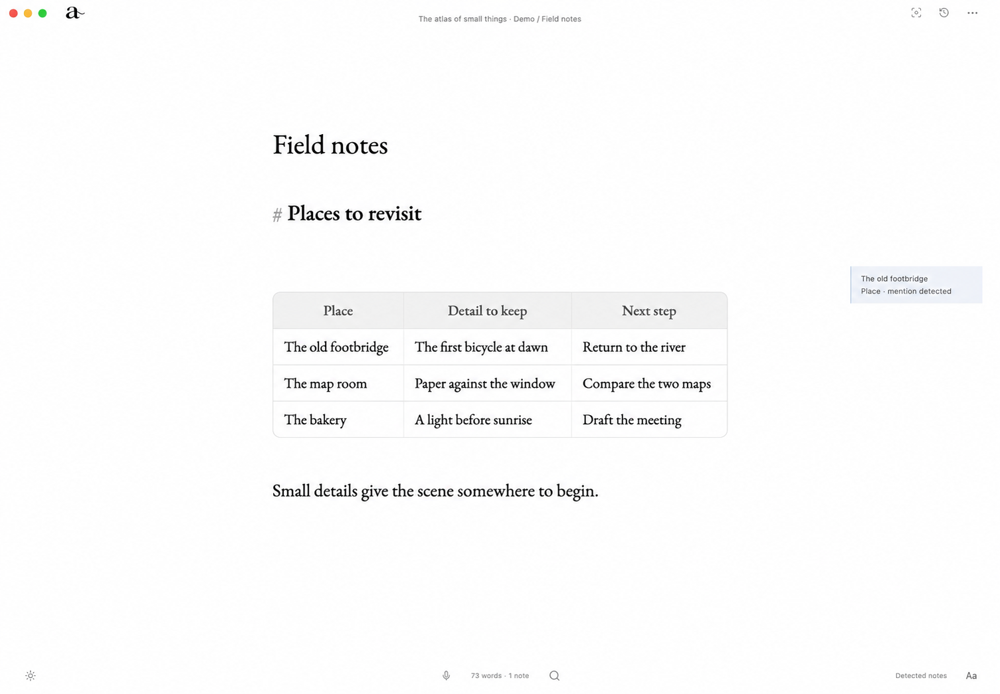

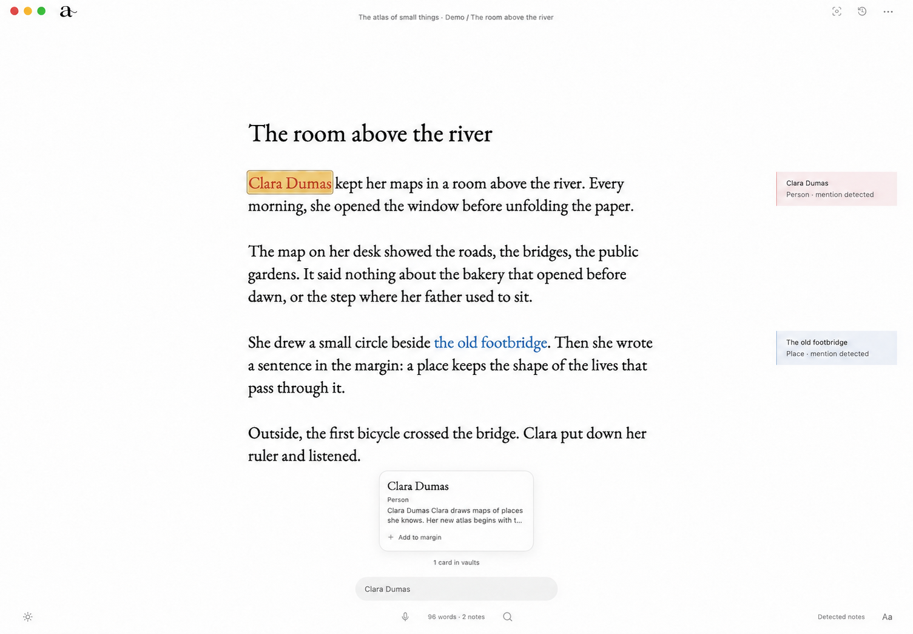

</details>

## Find a rhythm, then revisit the draft

Keep a **word, sentence or paragraph** in focus while the surrounding text dims. Typewriter scrolling keeps your place on the page; optional mechanical key and carriage-return sounds add an audible rhythm. Check words, characters or lines from the counter, or begin a **25-minute Pomodoro**.

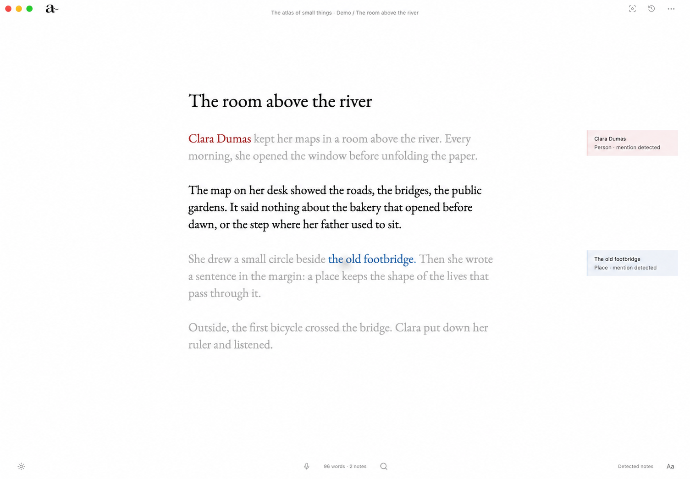

<details>
<summary>See immersive focus mode</summary>


</details>

Versions are saved automatically as you write, after a pause and when leaving a text. Keep a named draft before trying another direction. Compare earlier and current wording side by side, move through the changes and recover an individual passage. ariane saves a version before applying a passage or restoring a snapshot. Automatic history is deduplicated and bounded; named drafts stay preserved.

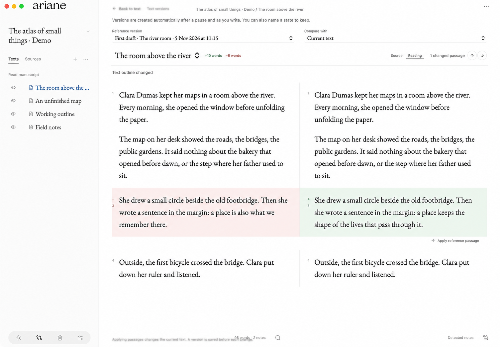

## Local assistance, at your request

Optional **local dictation** lets you speak a thought into the page. Click for continuous dictation, or hold the microphone button to talk and release to transcribe. Project names and aliases supply its lexicon. Review uncertain names and recover the original transcript when cleanup changes the wording.

For revision, select a passage and ask ariane to review it. Grammar suggestions appear first, followed by suggestions from the local model, using nearby text as context. Each correction needs your choice. Suggestions can be wrong or miss something; your manuscript remains yours to revise.

Entity detection, dictation and revision use engines running on your Mac. An Internet connection is needed to download and install the engines and models. **You can write, save and export without installing the optional modules.**

## A manuscript you can take with you

Export the whole manuscript or the current section as **Markdown, PDF, Word or EPUB**, with citations. The project stays local in SQLite with readable Markdown mirrors. ariane detects conflicting external edits and preserves a recovery copy during resolution.

<details>
<summary>Choose an export format</summary>

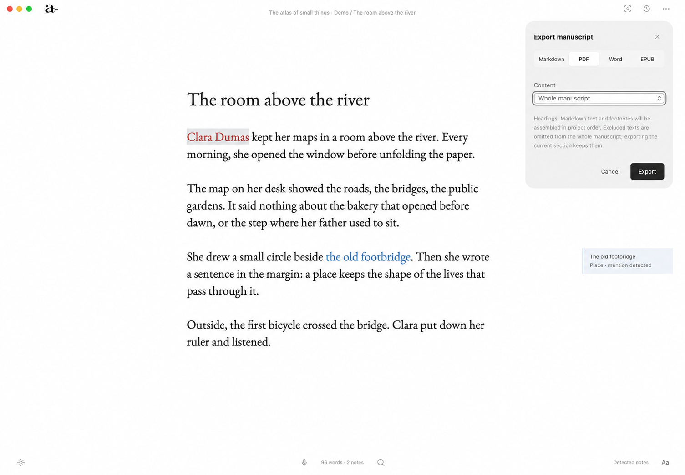

</details>

## See ariane in action

**[Watch the film · 59.5 seconds](https://github.com/absalonCRC/ariane/raw/refs/heads/main/docs/media/ariane-film.mp4)**

[](https://github.com/absalonCRC/ariane/raw/refs/heads/main/docs/media/ariane-film.mp4)

**This film is an earlier look at ariane 0.2.0-alpha.1, not a recording of the current interface.** The screenshots above show 0.3.2. The film follows native interactions on macOS: live Markdown, automatic entity colors and entry creation, search results, local transcription, mouse outlining, focus, word counts, Pomodoro and draft comparison. It opens on a line being typed, with ariane’s mechanical key sounds before the music. A male English voice-over follows the actions, with animated paper-and-thread transitions made using Imagegen and Fal.

The dictation sequence uses GPT-generated audio supplied to the real local transcription and editor pipeline in a dedicated capture build. [Recording methods and media provenance](docs/media/README.md) explain the setup.

_The Human Thread_ is fictional demo material about AI and authorship. The newer _The Connected Page_ project uses illustrative prose naming Ada Lovelace and London, rather than historical quotations.

[Explore the demo material](examples/the-human-thread) · [Media provenance and film transcript](docs/media/README.md)

## Try ariane

**ariane 0.3.2 is experimental and targets Apple Silicon Macs running macOS 26 or later.** A notarized, ready-to-download application is not available yet. This version can be built from source.

There are currently **no GitHub releases**. A public application release will follow signing, notarization and installation validation. [Previous source tag](https://github.com/absalonCRC/ariane/tree/v0.2.0-alpha.1) · [Detailed build guide](docs/building.md) · [0.3.2 development notes](docs/release-notes-0.3.2.md) · [Roadmap to 1.0.0](docs/roadmap-1.0.0.md)

<details>
<summary>Build from source</summary>

Requirements: an Apple Silicon Mac with macOS 26+, Xcode command-line tools, Node.js 24+, Rust/Cargo 1.95.0 and Python 3.11+. Allow several GB for resources and build artifacts. Homebrew is not required to prepare the engines.

```sh
npm ci
python3 scripts/setup-resources.py
npm run verify
npm run tauri build -- --bundles app
open src-tauri/target/release/bundle/macos/ariane.app
```

Resource preparation downloads pinned native engines and EmbeddingGemma 300M Q8 (about 334 MB). The [Gemma terms](https://ai.google.dev/gemma/terms) apply to that model. A locally built bundle is signed ad hoc and is not notarized.

For development, run `npm run tauri dev`. `npm run dev` starts a browser preview with simulated data; it does not access native project files.
</details>

### Optional modules

From the source checkout, with Python and [uv](https://docs.astral.sh/uv/getting-started/installation/) installed:

```sh
python3 scripts/setup-memory.py    # Manuscript entities: GLiNER
python3 scripts/setup-voice.py     # Dictation: Parakeet and Spokenly Cleanup
python3 scripts/setup-revision.py  # Revision: LanguageTool and SalamandraTA
```

These experimental modules are installed in ariane’s local application data. Base semantic retrieval uses EmbeddingGemma; the active installer no longer uses E5.

For an existing revision installation, run `python3 scripts/setup-revision.py --repair-jna` to apply the verified native-library fix while retaining the previous libraries.

### Current limits

- Back up **the entire project folder with the application closed**. Built-in history does not replace an independent backup.
- ariane has no remote sync, OCR, Windows, Linux or Intel Mac build.
- AI suggestions can miss errors or propose incorrect changes. Dictation evaluation so far uses synthetic voices on an M1 iMac; rare names, human voices and other hardware still need validation. See the [0.2.2 validation report](docs/validation-ia-2026-11-04.md).
- Forced termination at every write stage, low-disk-space handling and every Word rendering scenario are not fully qualified yet.
- PDF, Word and EPUB exports support images local to the project. Remote resources, escaping symlinks and raw HTML, TeX or Typst fragments are rejected. Markdown export preserves the text.

More detail: [usage guide](docs/usage.md) · [architecture](docs/architecture.md) · [changelog](CHANGELOG.md). Some detailed guides are currently in French.

## Contribute

Feedback on writing workflows, reproducible bug reports and code contributions are welcome. [Report a problem or propose an idea](https://github.com/absalonCRC/ariane/issues/new/choose). See [CONTRIBUTING.md](CONTRIBUTING.md) for preparing a report without personal data, and [SECURITY.md](SECURITY.md) to report a vulnerability privately.

## License

Copyright © 2026 Axel de Saint-Germain. ariane’s original code is licensed under **GNU GPL version 3 only** ([LICENSE](LICENSE), [COPYRIGHT](COPYRIGHT)). Libraries, fonts, styles and models retain their own licenses and terms; see [THIRD_PARTY.md](THIRD_PARTY.md).

[Media provenance and film transcript](docs/media/README.md).
