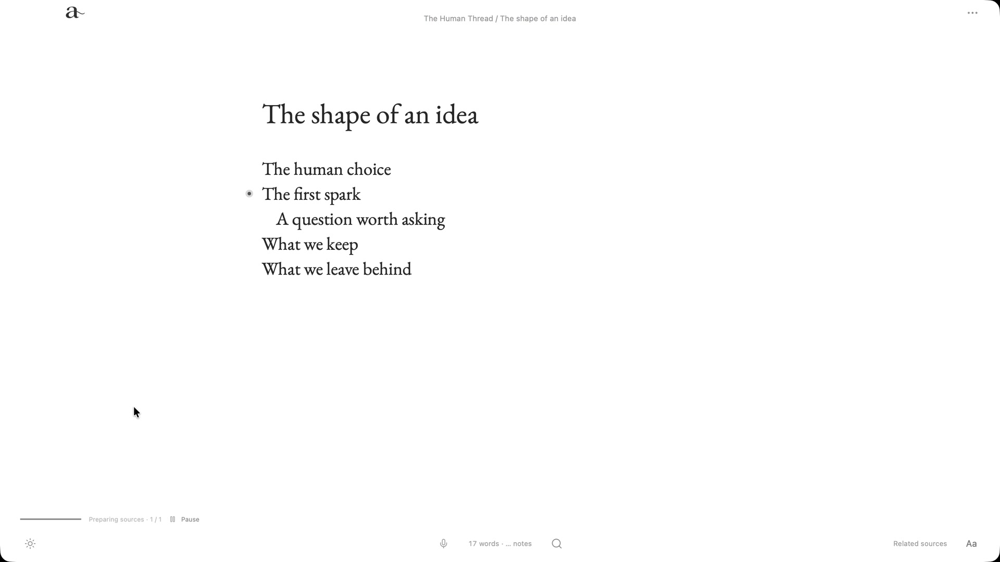
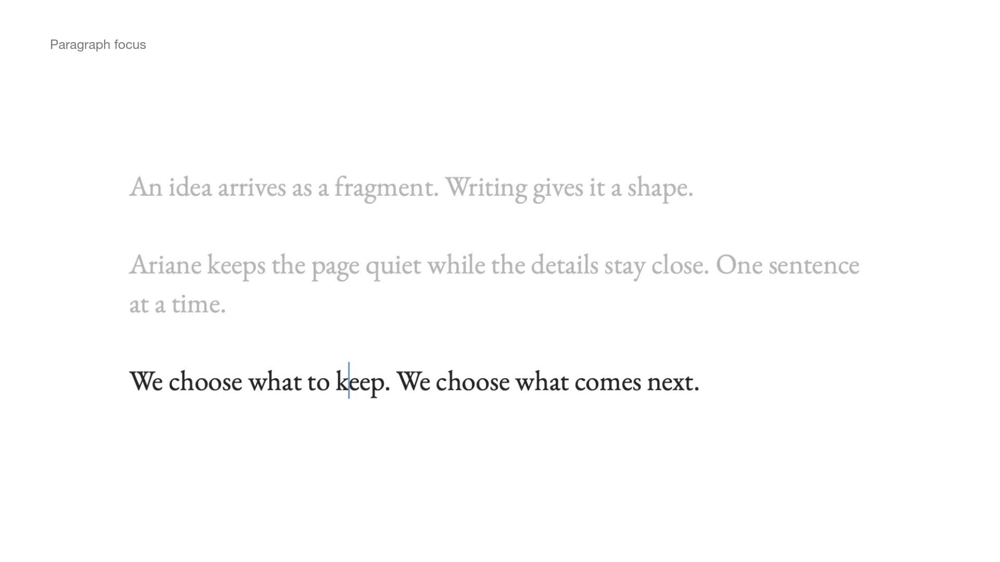
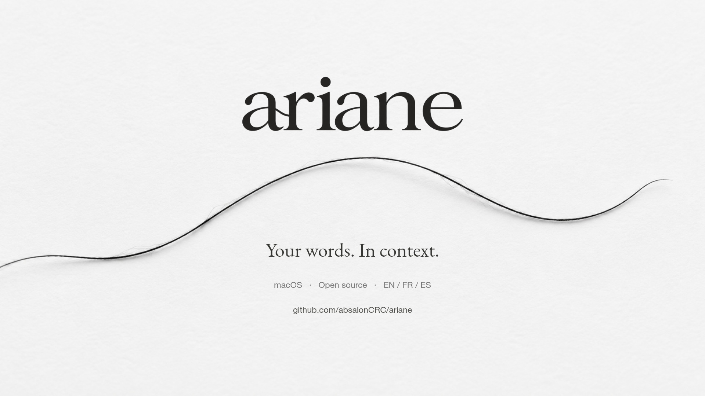

<div align="center">
  <picture>
    <source media="(prefers-color-scheme: dark)" srcset="docs/media/ariane-wordmark-light.png">
    
  </picture>
  <p><strong>Keep the human thread.</strong></p>
  <p>A quiet, local writing app for your manuscript, research and optional AI assistance on your Mac.</p>
  <p>English · Français · Español</p>
  <p><a href="#a-page-with-room-to-think">Discover ariane</a> · <a href="#see-ariane-in-action">Watch the film</a> · <a href="#try-ariane">Try ariane</a></p>
</div>

[](docs/media/writing.jpg)

## A page with room to think

A title. Your words. Room around them. The library stays tucked away until you need it. Open your manuscript’s structure, then return to the page.

Adjust the reading width, line spacing and focus mode to suit the way you write. ariane keeps the tools within reach and gives the sentence the space.

## The right context, beside the sentence

Names in your draft receive automatic colors by entity type and stay visible while you edit their context. Newly detected entities automatically receive an entry in the project’s vault; ambiguous names ask you to choose an existing entry or create a separate one. Add aliases to an entry so former names and pseudonyms refer to that same entry, or open an existing research note beside the sentence. Inspect its source and linked passages, then insert a reference when it belongs in your work.


Use an existing Obsidian vault in **read-only mode**, or create a vault owned by the project. Local memory can suggest related research notes and bring back earlier manuscript passages, with links to their source. Mentions with the same name retain separate passage references. You decide what is relevant; a suggestion is not a verified claim.

<details>
<summary>From a source card to the full note</summary>

<p align="center"></p>

</details>

## Keep the thought. Reconsider the sentence.

Versions are saved automatically as you write, after a pause and when leaving a text. Automatic captures are grouped into writing sessions; naming a capture preserves it permanently. Independent variants keep their own drafts and automatic history. Review wording, choose passages, and resolve differences before integrating a variant into the main text. The previous state stays recoverable. See [Versions and writing variants](docs/versionnement-ecriture.md) for the workflow, migration and recovery details.


*Two excerpts from the side-by-side comparison, stacked here for readability.*

## A structure that stays out of the way

Chapters, scenes and working notes sit behind the page. Reorder them, read the assembled manuscript or import writing into the open project.

Inside a page, the **outliner** lets you nest ideas, move an entire branch and fold it away. Drag a line above, below or inside another line, or use the keyboard to reshape the thought.



**Live Markdown** renders headings, emphasis and tables while you write. Table cells remain directly editable, and the text stays portable.

<p align="center"></p>

## Your pace, your focus

Keep the current **word, paragraph or sentence** in focus, or use typewriter scrolling to keep your place on the page, with optional mechanical key and carriage-return sounds. Follow the word, character or line count, and start a **25-minute Pomodoro** when it is time to settle into a draft. Optional **local dictation** lets you capture a thought aloud. The project’s names and aliases keep its lexicon up to date. Review uncertain names and recover the original transcript when cleanup changes the wording.



## Daylight. Late night. Your language.

Light, dark and system themes. An interface in **English, French or Spanish**. Your language choice is remembered; your manuscript keeps its own language.


## Find it. Finish it. Take it with you.

Search project texts from the page. Find vault notes by wording or meaning, with priority for exact titles and unambiguous aliases. Export your whole manuscript or the current section as **Markdown, PDF, Word or EPUB**, with citations.

<details>
<summary>Search without leaving the page</summary>

<p align="center"></p>

</details>

<details>
<summary>Four formats, one export panel</summary>

<p align="center"></p>

</details>

The project stays local in SQLite with readable Markdown mirrors. ariane detects conflicting external edits and preserves a recovery copy during resolution.

## See ariane in action

**[Watch the film · 59.5 seconds](https://github.com/absalonCRC/ariane/raw/refs/heads/main/docs/media/ariane-film.mp4)**

[](https://github.com/absalonCRC/ariane/raw/refs/heads/main/docs/media/ariane-film.mp4)

The film follows native interactions in **ariane 0.2.0-alpha.1 on macOS**: live Markdown, automatic entity colors and entry creation, search results, local transcription, mouse outlining, focus, word counts, Pomodoro and draft comparison. It opens on a line being typed, with ariane’s mechanical key sounds before the music. A male English voice-over follows the actions, with animated paper-and-thread transitions made using Imagegen and Fal.

The dictation sequence uses GPT-generated audio supplied to the real local transcription and editor pipeline in a dedicated capture build. [Recording methods and media provenance](docs/media/README.md) explain the setup.

*The Human Thread* is fictional demo material about AI and authorship. The newer *The Connected Page* project uses illustrative prose naming Ada Lovelace and London, rather than historical quotations.

[Explore the demo material](examples/the-human-thread) · [Media provenance and film transcript](docs/media/README.md)

## Local by design

**No account or cloud service is required to write.** Your manuscript and its processing stay on your Mac. Engines and models need an Internet connection when they are downloaded and installed.

Optional local modules add entity detection, dictation and revision assistance. For a selected passage, revision shows grammar suggestions first, followed by suggestions from the local model. Nearby text supplies context. Revision suggestions remain yours to review; each correction needs your choice. You can write, save and export without installing these modules.

ariane is for novels, essays, documented narratives, theses and any long-form work that grows alongside research. It also works as a quiet place to write with no connected vault.

## Try ariane

**ariane 0.3.1 is experimental and targets Apple Silicon Macs running macOS 26 or later.** A notarized, ready-to-download application is not available yet. This version can be built from source.

There are currently **no GitHub releases**. A public application release will follow signing, notarization and installation validation. [Previous source tag](https://github.com/absalonCRC/ariane/tree/v0.2.0-alpha.1) · [Detailed build guide](docs/building.md) · [0.3.1 development notes](docs/release-notes-0.3.1.md) · [Roadmap to 1.0.0](docs/roadmap-1.0.0.md)

<details>
<summary>Build from source</summary>

Requirements: an Apple Silicon Mac with macOS 26+, Xcode command-line tools, Node.js 24+, Rust/Cargo 1.95.0 and Python 3.11+. Allow several GB for resources and build artifacts. Homebrew is not required to prepare the engines.

```sh
npm ci
python3 scripts/setup-resources.py
npm run verify
npm run tauri build -- --bundles app
open src-tauri/target/release/bundle/macos/ariane.app
```

Resource preparation downloads pinned native engines and EmbeddingGemma 300M Q8 (about 334 MB). The [Gemma terms](https://ai.google.dev/gemma/terms) apply to that model. A locally built bundle is signed ad hoc and is not notarized.

For development, run `npm run tauri dev`. `npm run dev` starts a browser preview with simulated data; it does not access native project files.
</details>

### Optional modules

From the source checkout, with Python and [uv](https://docs.astral.sh/uv/getting-started/installation/) installed:

```sh
python3 scripts/setup-memory.py    # Manuscript entities: GLiNER
python3 scripts/setup-voice.py     # Dictation: Parakeet and Spokenly Cleanup
python3 scripts/setup-revision.py  # Revision: LanguageTool and SalamandraTA
```

These experimental modules are installed in ariane’s local application data. Base semantic retrieval uses EmbeddingGemma; the active installer no longer uses E5.

For an existing revision installation, run `python3 scripts/setup-revision.py --repair-jna` to apply the verified native-library fix while retaining the previous libraries.

### Current limits

- Back up **the entire project folder with the application closed**. Built-in history does not replace an independent backup.
- ariane has no remote sync, OCR, Windows, Linux or Intel Mac build.
- AI suggestions can miss errors or propose incorrect changes. Dictation evaluation so far uses synthetic voices on an M1 iMac; rare names, human voices and other hardware still need validation. See the [0.2.2 validation report](docs/validation-ia-2026-11-04.md).
- Forced termination at every write stage, low-disk-space handling and every Word rendering scenario are not fully qualified yet.
- PDF, Word and EPUB exports support images local to the project. Remote resources, escaping symlinks and raw HTML, TeX or Typst fragments are rejected. Markdown export preserves the text.

More detail: [usage guide](docs/usage.md) · [architecture](docs/architecture.md) · [changelog](CHANGELOG.md). Some detailed guides are currently in French.

## Contribute

Feedback on writing workflows, reproducible bug reports and code contributions are welcome. [Report a problem or propose an idea](https://github.com/absalonCRC/ariane/issues/new/choose). See [CONTRIBUTING.md](CONTRIBUTING.md) for preparing a report without personal data, and [SECURITY.md](SECURITY.md) to report a vulnerability privately.

## License

Copyright © 2026 Axel de Saint-Germain. ariane’s original code is licensed under **GNU GPL version 3 only** ([LICENSE](LICENSE), [COPYRIGHT](COPYRIGHT)). Libraries, fonts, styles and models retain their own licenses and terms; see [THIRD_PARTY.md](THIRD_PARTY.md).

[Media provenance and film transcript](docs/media/README.md).
