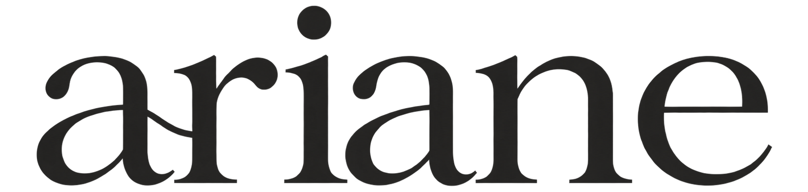
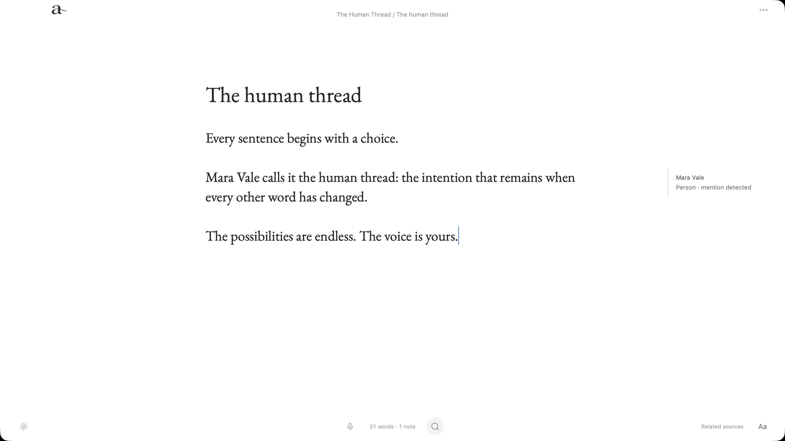
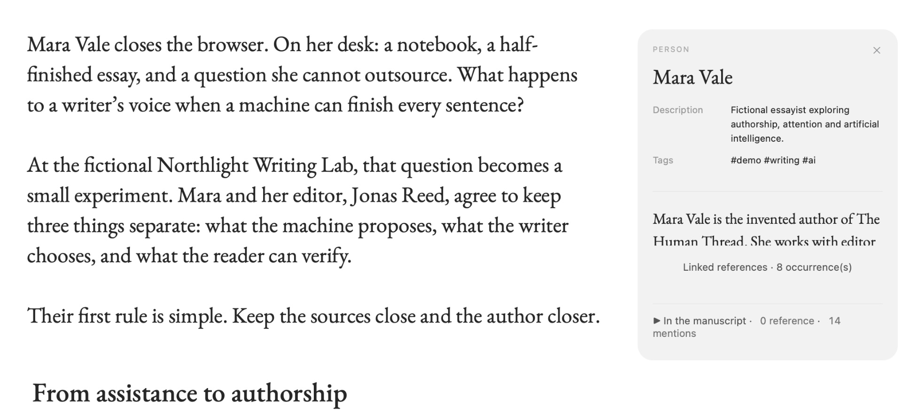
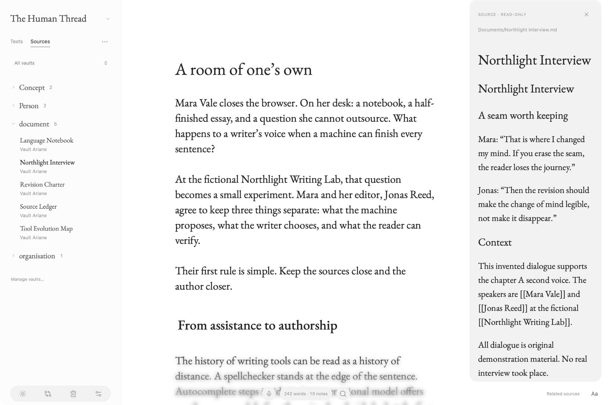
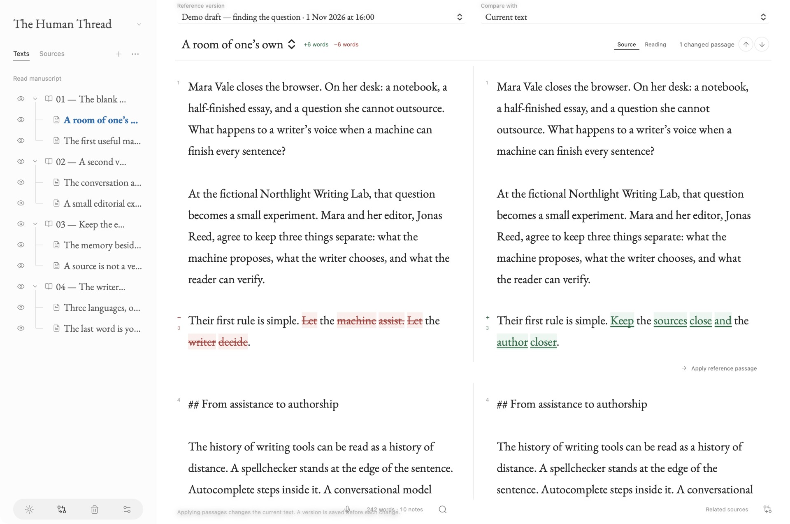
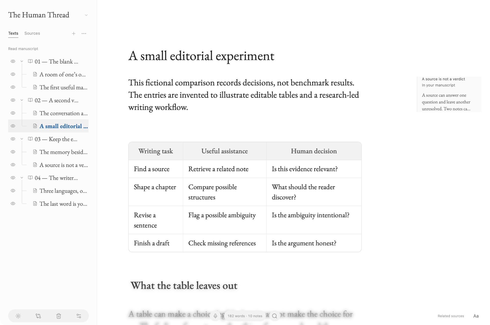
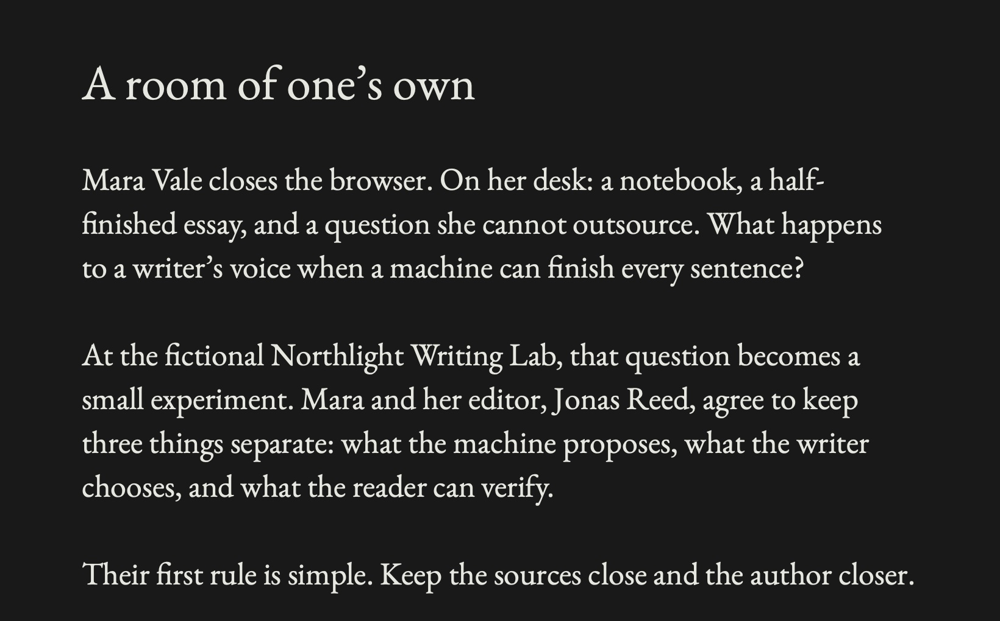
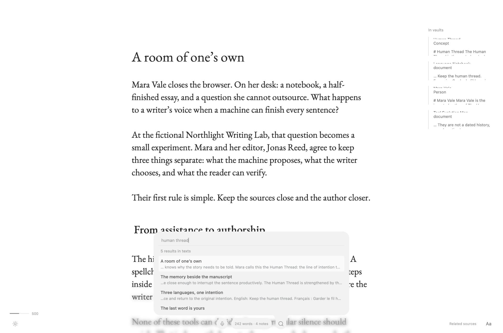
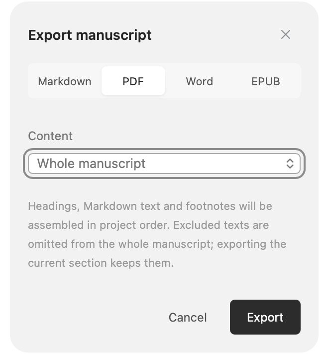

<div align="center">
  <picture>
    <source media="(prefers-color-scheme: dark)" srcset="docs/media/ariane-wordmark-light.png">
    
  </picture>
  <p><strong>Keep the human thread.</strong></p>
  <p>A quiet, local space for your manuscript and the knowledge around it.</p>
  <p>English · Français · Español</p>
  <p><a href="#a-page-with-room-to-think">Discover Ariane</a> · <a href="#see-ariane-in-action">Watch the film</a> · <a href="#try-the-alpha">Try the alpha</a></p>
</div>

[](docs/media/writing.jpg)

## A page with room to think

A title. Your words. Room around them. The library stays tucked away until you need it. Open your manuscript’s structure, then return to the page.

Adjust the reading width, line spacing and focus mode to suit the way you write. Ariane keeps the tools within reach and gives the sentence the space.

## The right context, beside the sentence

A name in your draft can lead back to a research note. Inspect the source, see where it appears in the manuscript, and insert a reference when it belongs in your work.



Use an existing Obsidian vault in **read-only mode**, or create a vault owned by the project. Local semantic retrieval can suggest related notes and passages. You decide what is relevant; a suggestion is not a verified claim.

<details>
<summary>From a source card to the full note</summary>

<p align="center"></p>

</details>

## Keep the thought. Reconsider the sentence.

Compare named drafts, inspect what changed and recover an individual passage. Ariane saves a version before applying a passage or restoring a snapshot.



*Two excerpts from the side-by-side comparison, stacked here for readability.*

## A structure that stays out of the way

Chapters, scenes and working notes sit behind the page. Reorder them, read the assembled manuscript or import writing into the open project. Markdown tables are directly editable, so comparisons stay readable while the text remains portable.

<p align="center"></p>

## Daylight. Late night. Your language.

Light, dark and system themes. An interface in **English, French or Spanish**. Your language choice is remembered; your manuscript keeps its own language.



## Find it. Finish it. Take it with you.

Search project texts and connected vaults from the page. Export your whole manuscript or the current section as **Markdown, PDF, Word or EPUB**, with citations.

<details>
<summary>Search without leaving the page</summary>

<p align="center"></p>

</details>

<details>
<summary>Four formats, one export panel</summary>

<p align="center"></p>

</details>

The project stays local in SQLite with readable Markdown mirrors. Ariane detects conflicting external edits and preserves a recovery copy during resolution.

## See Ariane in action

**[Watch the film · 46 seconds](https://github.com/absalonCRC/ariane/raw/refs/heads/main/docs/media/ariane-film.mp4)**

The presentation uses **0.2.0-alpha.1 running natively on macOS**. Product details are enlarged from real captures. *The Human Thread* is a fictional essay about AI and authorship, with four chapters, eight pages, ten research notes and two sample drafts. All people, institutions and interviews are invented.

[Explore the demo material](examples/the-human-thread) · [Media provenance and film transcript](docs/media/README.md)

## Local by design

**No account or cloud service is required to write.** Your manuscript and its processing stay on your Mac. Engines and models need an Internet connection when they are downloaded and installed.

Optional local modules add entity detection, dictation and revision assistance. Suggestions remain yours to review; corrections are not applied without your choice. You can write, save and export without installing these modules.

Ariane is for novels, essays, documented narratives, theses and any long-form work that grows alongside research. It also works as a quiet place to write with no connected vault.

## Try the alpha

**Ariane 0.2.0-alpha.1 is experimental and targets Apple Silicon Macs running macOS 26 or later.** A notarized, ready-to-download application is not available yet. This version can be built from source.

There are currently **no GitHub releases**. A public application release will follow signing, notarization and installation validation. [Browse the source tag](https://github.com/absalonCRC/ariane/tree/v0.2.0-alpha.1) · [Detailed build guide](docs/building.md)

<details>
<summary>Build from source</summary>

Requirements: an Apple Silicon Mac with macOS 26+, Xcode command-line tools, Node.js 24+, Rust/Cargo 1.95.0 and Python 3.11+. Allow several GB for resources and build artifacts. Homebrew is not required to prepare the engines.

```sh
npm ci
python3 scripts/setup-resources.py
npm run verify
npm run tauri build -- --bundles app
open src-tauri/target/release/bundle/macos/Ariane.app
```

Resource preparation downloads pinned native engines and EmbeddingGemma 300M Q8 (about 334 MB). The [Gemma terms](https://ai.google.dev/gemma/terms) apply to that model. A locally built bundle is signed ad hoc and is not notarized.

For development, run `npm run tauri dev`. `npm run dev` starts a browser preview with simulated data; it does not access native project files.
</details>

### Optional modules

From the source checkout, with Python and [uv](https://docs.astral.sh/uv/getting-started/installation/) installed:

```sh
python3 scripts/setup-memory.py    # Manuscript entities: GLiNER
python3 scripts/setup-voice.py     # Dictation: Parakeet and Spokenly Cleanup
python3 scripts/setup-revision.py  # Revision: LanguageTool and SalamandraTA
```

These experimental modules are installed in Ariane’s local application data. Base semantic retrieval uses EmbeddingGemma; the active installer no longer uses E5.

### Current limits

- Back up **the entire project folder with the application closed**. Built-in history does not replace an independent backup.
- The alpha has no remote sync, OCR, Windows, Linux or Intel Mac build.
- Forced termination at every write stage, low-disk-space handling and every Word rendering scenario are not fully qualified yet.
- PDF, Word and EPUB exports support images local to the project. Remote resources, escaping symlinks and raw HTML, TeX or Typst fragments are rejected. Markdown export preserves the text.

More detail: [usage guide](docs/usage.md) · [architecture](docs/architecture.md) · [changelog](CHANGELOG.md). Some detailed guides are currently in French.

## Contribute

Feedback on writing workflows, reproducible bug reports and code contributions are welcome. [Report a problem or propose an idea](https://github.com/absalonCRC/ariane/issues/new/choose). See [CONTRIBUTING.md](CONTRIBUTING.md) for preparing a report without personal data, and [SECURITY.md](SECURITY.md) to report a vulnerability privately.

## License

Copyright © 2026 Axel de Saint-Germain. Ariane’s original code is licensed under **GNU GPL version 3 only** ([LICENSE](LICENSE), [COPYRIGHT](COPYRIGHT)). Libraries, fonts, styles and models retain their own licenses and terms; see [THIRD_PARTY.md](THIRD_PARTY.md).

[Media provenance and film transcript](docs/media/README.md).
