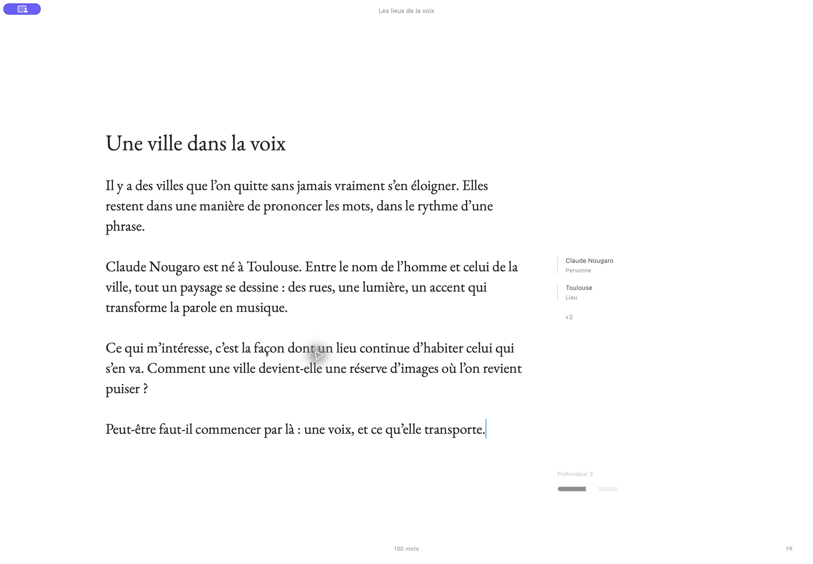
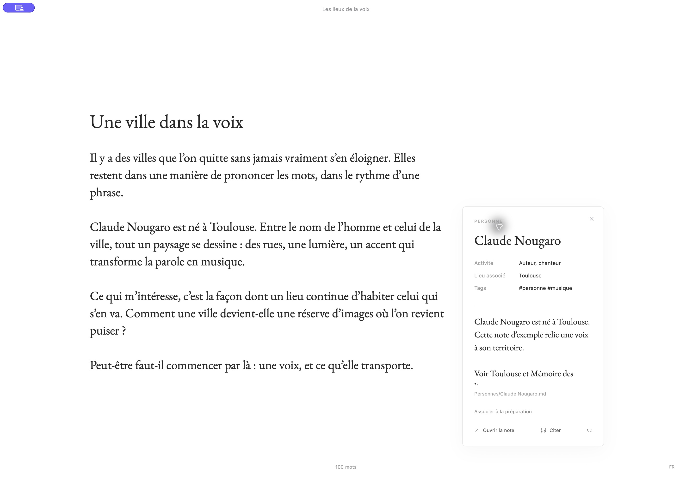

<div align="center">
  
  <p><strong>Un lieu pour écrire. Des sources à portée de pensée.</strong></p>
  <p>Un éditeur Markdown local pour les textes longs, conçu pour macOS.</p>
  <p>
    <a href="#découvrir-ariane">Découvrir Ariane</a> ·
    <a href="#essayer-lalpha">Essayer l’alpha</a> ·
    <a href="#contribuer">Contribuer</a>
  </p>
  <p><a href="https://github.com/absalonCRC/ariane/actions/workflows/verify.yml"></a> <a href="LICENSE"></a> </p>
</div>

---

Vous écrivez un chapitre, un essai ou un article. Une personne, un lieu ou une idée apparaît dans votre texte : Ariane peut retrouver la fiche correspondante dans vos sources et vous la proposer dans la marge. Vous consultez le contexte, insérez une citation si elle vous est utile, puis revenez à votre phrase.

Ariane réunit l’espace d’écriture, la structure du manuscrit et les documents de recherche dans une application locale. Le texte reste au centre ; les outils apparaissent quand vous en avez besoin.



*Capture d’une version de développement, avec un projet et des notes de démonstration. L’interface de l’alpha peut différer.*

## Découvrir Ariane

### Écrire sans perdre le fil

La page d’écriture privilégie la lecture et la concentration. Organisez votre projet en dossiers, chapitres et scènes ; structurez les passages à l’intérieur d’une scène, déplacez leurs branches et repliez ce qui ne vous sert pas pour le moment. Les modes de concentration et le défilement « machine à écrire » accompagnent votre façon de travailler.

### Garder ses recherches près du texte

Reliez un vault Obsidian existant en lecture seule, ou créez un vault propre à votre projet. Ariane repère dans le manuscrit les personnes, lieux et autres notes correspondantes, puis les présente dans la marge. Ouvrez une fiche pour consulter son contexte ou citer une source, sans quitter l’écriture.

<details>
<summary>Voir un exemple de fiche source</summary>
<br>



*Capture de développement avec une note de démonstration.*
</details>

### Construire un manuscrit dans la durée

Retrouvez des versions de votre texte, comparez-les et restaurez un état antérieur. Ariane conserve le projet localement dans une base SQLite et des fichiers Markdown lisibles ; en cas de modification externe, elle signale le conflit et conserve une copie de récupération. Exportez votre travail en **Markdown, PDF, Word ou EPUB**, avec vos citations.

### Retrouver et réviser, à votre rythme

La recherche locale peut suggérer des passages proches et aider à retrouver le contexte d’un manuscrit. Des modules facultatifs ajoutent la détection d’entités, la dictée et la révision locales. Les suggestions sont à examiner : aucune correction n’est appliquée sans votre choix.

## Pour qui ?

Ariane s’adresse aux personnes qui écrivent des textes longs et s’appuient sur des notes : roman, récit documenté, essai, mémoire ou recherche. Elle peut aussi servir à écrire simplement, sans connecter de vault ni installer les modules facultatifs.

**Pas de compte ni de service cloud pour écrire.** Le manuscrit et son traitement restent sur le Mac. Les moteurs et modèles sont téléchargés lors de leur installation ; une connexion Internet est donc nécessaire à cette étape. Les vaults externes connectés restent en lecture seule.

## Essayer l’alpha

**Ariane 0.1.0-alpha.1 est une version expérimentale, destinée aux Mac Apple Silicon sous macOS 26 ou ultérieur.** Elle n’est pas encore proposée sous forme d’application notarifiée prête à télécharger. Les personnes à l’aise avec les outils de développement peuvent la construire depuis les sources.

[Voir la prérelease et ses sources](https://github.com/absalonCRC/ariane/releases/tag/v0.1.0-alpha.1) · [Guide de construction détaillé](docs/building.md)

<details>
<summary>Construire l’application depuis les sources</summary>

Prérequis : Mac Apple Silicon sous macOS 26+, outils de ligne de commande Xcode, Node.js 24+, Rust/Cargo 1.95.0 et Python 3.11+. Prévoir plusieurs Go pour les ressources et la compilation. Homebrew n’est pas nécessaire à la préparation des moteurs.

```sh
npm ci
python3 scripts/setup-resources.py
npm run verify
npm run tauri build -- --bundles app
open src-tauri/target/release/bundle/macos/Ariane.app
```

La préparation télécharge les moteurs natifs verrouillés et EmbeddingGemma 300M Q8 (environ 334 Mo). Les [conditions Gemma](https://ai.google.dev/gemma/terms) s’appliquent au modèle. Le paquet construit localement est signé ad hoc et n’est pas notarifié.

Pour développer, utilisez `npm run tauri dev`. `npm run dev` lance un aperçu navigateur avec des données simulées ; il ne donne pas accès aux fichiers natifs.
</details>

### Modules facultatifs

Depuis les sources, avec Python et [uv](https://docs.astral.sh/uv/getting-started/installation/) installés :

```sh
python3 scripts/setup-memory.py    # Entités du manuscrit : GLiNER
python3 scripts/setup-voice.py     # Dictée : Parakeet et Spokenly Cleanup
python3 scripts/setup-revision.py  # Révision : LanguageTool et SalamandraTA
```

Ces modules sont installés dans les données locales d’Ariane. Ils ne sont pas nécessaires pour écrire, sauvegarder ou exporter et restent expérimentaux. La recherche sémantique de base utilise EmbeddingGemma ; l’installateur actif n’utilise plus E5.

## Avant de commencer

- Sauvegardez **le dossier entier du projet**, application fermée. L’historique intégré ne remplace pas une sauvegarde indépendante.
- L’alpha ne propose pas de synchronisation distante, d’OCR, ni de version Windows, Linux ou Mac Intel.
- Les arrêts forcés à chaque étape d’écriture, le manque d’espace disque et tous les rendus Word ne sont pas encore entièrement qualifiés.
- Les exports PDF, Word et EPUB acceptent les images locales au projet ; les ressources distantes, liens symboliques sortants et fragments HTML/TeX/Typst bruts sont refusés. L’export Markdown conserve le texte.

Pour aller plus loin : [guide d’utilisation](docs/usage.md) · [architecture](docs/architecture.md) · [journal des changements](CHANGELOG.md).

## Contribuer

Les retours sur les parcours d’écriture, les bugs reproductibles et les contributions au code sont les bienvenus. [Signalez un problème ou proposez une idée](https://github.com/absalonCRC/ariane/issues/new/choose). Consultez [CONTRIBUTING.md](CONTRIBUTING.md) pour préparer un exemple sans données personnelles, et [SECURITY.md](SECURITY.md) pour signaler une vulnérabilité en privé.

## Licence

Copyright © 2026 Axel de Saint-Germain. Le code original d’Ariane est distribué sous **GNU GPL version 3 uniquement** ([LICENSE](LICENSE), [COPYRIGHT](COPYRIGHT)). Les bibliothèques, polices, styles et modèles conservent leurs licences et conditions propres : voir [THIRD_PARTY.md](THIRD_PARTY.md).
