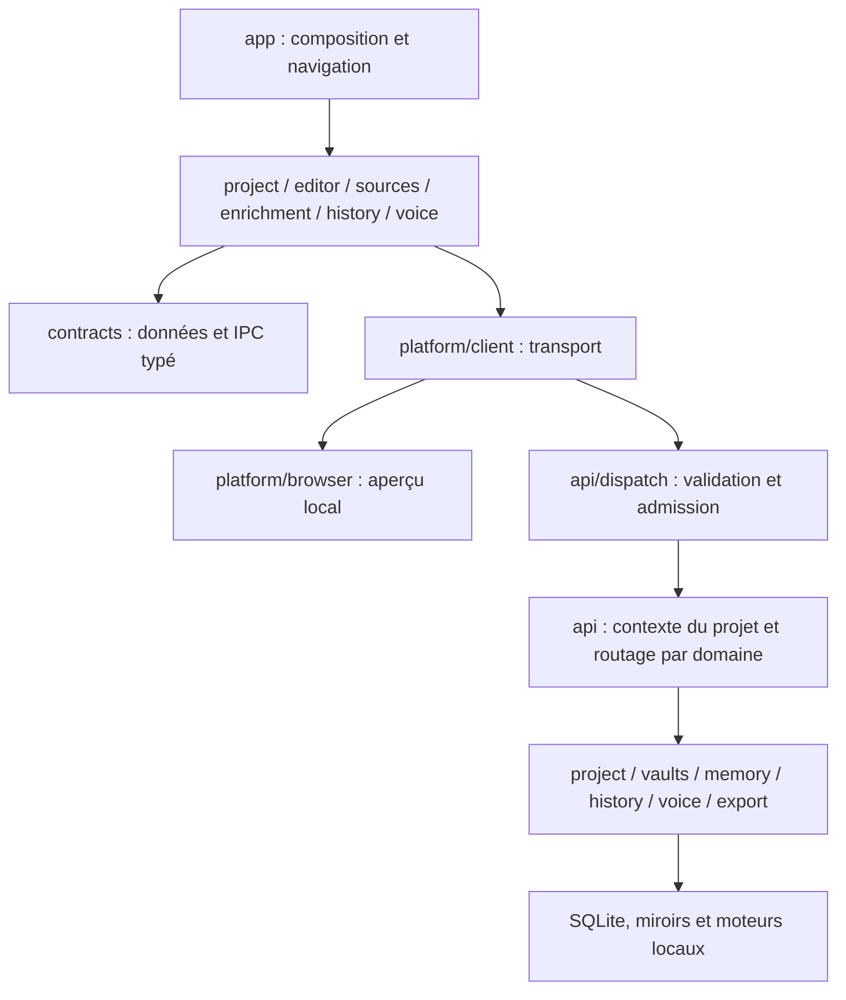

# Organisation du code

Ariane est une application macOS Tauri 2, Rust, React/TypeScript et CodeMirror 6. Elle conserve les projets localement et sépare l’écriture, les sources externes et les traitements documentaires. Ce document décrit le code après la refactorisation modulaire de novembre 2026 ; les fonctionnalités retirées restent décrites dans `annulations-2026-11-01.md`.

## Frontières des modules

Les contrats ne dépendent ni de React, ni de Tauri, ni des contrôleurs. Les fonctions métier ne dépendent pas d’`App` ou du type global `Workspace`. Les interfaces de domaine sont importées directement depuis leur propriétaire ; les anciennes façades `app/types.ts` et `app/client.ts` ont été retirées.

`npm run verify:architecture` vérifie ces frontières et la présence des mêmes 92 noms de commandes dans `Requests`, `Responses` et l’énumération Rust. Ce contrôle ne prouve pas l’équivalence de chaque champ JSON : les tests de comportement, le témoin IPC partagé et la recette native complètent le typage.

## Frontend : responsabilités et état

| Module | Responsabilité et propriétaire de l’état |
| --- | --- |
| `app/App.tsx` | Compose les domaines, relie leurs événements, conserve les états de présentation transversaux et les points d’ancrage des portails. |
| `app/chrome/` | En-tête et géométrie du panneau commun recherche/dictée. `useBottomPanel` libère son observer et son timer. |
| `app/writing/WritingSurface.tsx` | Maintient titre et éditeur dans la même `.manuscript-column`, sans conteneur supplémentaire. Versions masque cette surface sans détruire l’éditeur. |
| `app/useWorkspace.ts` | Possède navigation, sélection, session et verrous des opérations UI ; compose les contrôleurs. `WorkspaceDialogs`, `WorkspaceNotices` et `useTitleNotices` sont des adaptateurs de cette couche de composition. |
| `app/commands/useWorkspaceCommands.ts` | Registre des commandes à identifiants stables, raccourcis et abonnement au menu natif. Conserve les différences de sauvegarde/navigation entre palette et menus natifs. |
| `project/useProject.ts` | Propriétaire unique des brouillons, de la file de sauvegarde et des révisions confirmées. Un échec conserve le tampon ; un acquittement ancien ne remplace pas une édition récente. |
| `project/operations.ts` | Opérations de bibliothèque, création, métadonnées, ouverture et réorganisation ; reçoit les mêmes verrous et files que le coordinateur. Aucun deuxième état de projet. |
| `project/Binder.tsx`, `project/binder/` | Vue de bibliothèque, contrôleur de sélection/virtualisation et ligne d’arbre. Les clés restent les identifiants des sections. La création prépare le nom dans la sidebar avant validation. |
| `editor/Editor.tsx`, `editor/runtime/` | Le composant possède les refs et les effets React ; `mount` possède une instance CodeMirror et son nettoyage ; `commands` expose l’interface impérative ; `revision` actualise les marques. |
| `sources/` | Lecteurs, recherche, navigation des sources et épinglage ; `actions` gère lecture/citation, `margin/DocumentaryMargin` rend la marge documentaire. |
| `enrichment/` | Suggestions et fiches dérivées du manuscrit. Les hooks reçoivent des interfaces d’entrée explicites, pas le type global `Workspace`. Leurs contrôles de contexte et de fraîcheur restent auprès des tâches asynchrones. |
| `history/` | `useHistory` possède chargements, sélection, comparaison, variantes et restauration ; `History` rend la vue ; `HistoryTools` rend les outils dans le portail existant. `useWritingBranches` synchronise la variante active avec la capsule du titre et attend la sauvegarde avant tout changement. Les états automatiques et les brouillons des variantes restent distincts. |
| `voice/` | `useVoiceSession` possède acquisition, sessions, files audio, annulation et nettoyage ; `VoiceButton` rend les commandes et contenus du panneau. |
| `export/`, `revision/` | Contrôleurs et vues existants : un export continue lorsque son dialogue est fermé ; les propositions de révision restent des suggestions. |

La saisie reste gérée par les transactions CodeMirror. React ne contrôle pas le texte à chaque touche. `sectionMapping`, les identifiants de l’outline, les offsets UTF-16, l’historique d’annulation et les abstractions de défilement restent communs aux commandes et au rendu. Le changement de panneau ne doit pas reconstruire l’éditeur.

`projectSearch.ts` calcule les occurrences sur les textes courants, brouillons compris. `useUnifiedSearch` interroge les vaults séparément, avec temporisation et rejet des réponses périmées. La navigation révèle les passages repliés. Les états durables du projet et les états d’affichage restent distincts.

## Contrats et plateformes

`contracts/` contient les DTO par domaine : projet, réglages, sources, versions, mémoire, entités, annotations, notes, import et révision. `requests.ts` associe une commande à ses paramètres et son résultat : les appelants ne choisissent plus arbitrairement le type de retour de `request`.

`platform/client.ts` sélectionne le transport. Dans Tauri, il invoque toujours `dispatch` avec `{ request: { type, ...paramètres } }`. `platform/browser/client.ts` conserve les clés de stockage et les possibilités de l’aperçu navigateur. Celui-ci ne simule ni accès aux fichiers natifs, ni inférence, ni fonctions retirées. Les résultats ignorés par tous les appelants restent explicitement `unknown` lorsque leur forme diffère entre plateformes ; ils doivent être précisés avant un nouvel usage.

Les commandes, événements, formats persistés, valeurs par défaut et ressources ne changent pas avec ce découpage. Le JSON `tests/fixtures/ipc-save.json` est consommé par les tests TypeScript et Rust pour vérifier notamment révisions, caractères accentués, emoji et offsets UTF-16.

## Backend : contexte, transactions et moteurs

- `api/request.rs` définit le protocole serde ; `api/state.rs` conserve les ressources partagées. `api/dispatch.rs` valide et admet la requête avant `spawn_blocking`, puis conserve le permis jusqu’à sa fin.
- `api/mod.rs` capture le projet courant et garde le verrou OS vivant pendant l’opération. Les modules `project_commands`, `memory_commands`, `vault_commands`, `source_commands` et `version_commands` routent vers les domaines. `api/session.rs` ne publie le nouveau projet actif qu’après ouverture et sauvegarde de session réussies.
- `project/schema.rs` possède ouverture de base, schéma et sauvegarde avant migration ; `queries.rs` lit les sections ; `mutations.rs` applique les mutations élémentaires ; `mirrors.rs` réconcilie les fichiers ; `storage.rs` garde la transaction de sauvegarde, les révisions et la reprise après commit. `library.rs`, `manuscript.rs`, `annotations.rs`, `links.rs` et `catalog.rs` conservent leurs responsabilités existantes.
- `memory/passages.rs` synchronise les passages et calcule les travaux en attente ; `memory/context.rs` lit contexte, entités, passages, session et rejets ; `memory/mod.rs` conserve l’application transactionnelle des résultats et la normalisation. Les files, caches, contrôles de fraîcheur et moteurs restent séparés dans leurs modules existants.
- `vaults/` lit les dossiers externes, YAML, tags, alias et PDF. L’index FTS5 et les données dérivées restent dans une base distincte. Une source externe s’ouvre en lecture seule ; une fiche appartenant à Ariane est distincte.
- `retrieval/` distingue identité exacte, liens explicites, tags et proximité sémantique. Les résultats restent filtrés par périmètre. `inference/`, `memory_engine/` et `voice/` conservent leurs processus, priorités et protocoles ; le découpage ne modifie aucun modèle ni seuil.
- `history/` conserve les versions de texte, structure, paramètres, références et annotations. Les variantes et leurs brouillons sont stockés dans SQLite ; la relecture compare une origine commune et conserve des points de retour avant intégration ou restauration. `export/` assemble et convertit avec les ressources locales existantes ; son annulation arrête le groupe de processus.
- `platform.rs` conserve les menus macOS et la demande de sauvegarde avant sortie. `app/useNativeClose.ts` partage le chemin de fermeture/quitter ; le backend attend la confirmation du frontend.

## Format de projet et invariants

Un dossier contient `ariane.sqlite`, `manuscrit/<identifiant>.md` et, si nécessaire, `recuperation/`. SQLite reste la source transactionnelle ; les Markdown sont des miroirs lisibles. La transaction est validée avant matérialisation. Une erreur de miroir ne transforme pas un commit réussi en perte des données ; la reprise, les conflits externes et les copies de récupération restent explicitement gérés.

Le schéma des versions passe à 2 avec une copie SQLite préalable dans `recuperation/`. Les origines, brouillons et parents de variantes sont stockés localement ; le journal d’activité des notes reste indépendant des restaurations. Les limites et exceptions des sauvegardes automatiques sont décrites dans [Versions et variantes d’écriture](versionnement-ecriture.md).

Les sections conservent rôle, inclusion et corbeille ; le champ historique `role` reste lisible sans imposer deux arborescences. La file de sauvegarde conserve les révisions et séquence les métadonnées avant les opérations qui en dépendent. Le catalogue `library.sqlite` et la dernière session ne remplacent pas les bases propres aux projets.

`import.rs` ajoute les textes convertis au projet actif dans une transaction et ne copie que les images nécessaires. Les annotations restent indépendantes du Markdown et des exports ; une annotation ambiguë n’est pas réattachée arbitrairement. Les fonctions retirées de réorganisation, de remplacement global ou d’import ne sont pas réintroduites.

## Styles et maintenance

Les points d’entrée `styles/editor.css` et `styles/surfaces.css` importent leurs groupes de règles dans un ordre explicite. Les autres feuilles gardent leur ordre de chargement. Les règles transversales et correctives restent dans leur position de cascade : ne pas les déplacer dans un composant sans vérifier leur priorité et les vues concernées.

Pour ajouter une fonction :

1. Définir les données dans le contrat métier approprié et, si elles traversent l’IPC, dans les modèles Rust et `contracts/requests.ts`.
2. Implémenter la règle dans son domaine ; garder un propriétaire unique de son état et de ses ressources.
3. Ajouter la variante dans `api/request.rs` et son routage dans le domaine concerné, sans déplacer les contrôles d’admission ou de contexte.
4. Composer la vue dans `App` avec les seules données et commandes nécessaires. Préserver montage, focus, sélection et nettoyage.
5. Vérifier les comportements concernés puis `npm run verify` avec `RUST_TEST_THREADS=1` pour les tests de moteurs locaux. Compléter par une recette navigateur et native selon les capacités touchées.

Les règles opérationnelles et les erreurs à éviter sont consignées dans `AGENTS.md`. La taille d’un fichier appelle une revue de responsabilités, pas une multiplication automatique de wrappers. `App`, le coordinateur de session et les contrôleurs de domaine gardent volontairement les interactions dont ils possèdent l’invariant.

## Activité des notes et chrome natif

Les ajouts fonctionnels qui suivent la refactorisation sont distincts des extractions mécaniques :

- `notes/useNoteActivity` possède le journal affiché, les écritures en attente, leur reprise et la pagination. Les événements automatiques possèdent une clé stable par contexte ; les actions explicites ont une clé unique pour rester répétables et pour que leur réessai soit idempotent. Les changements de projet et la fermeture attendent les écritures en attente.
- `notes/useNoteObservations` observe les détections et suggestions affichées ainsi que les ouvertures de cartes et de lecteurs. Les créations, classements, résolutions, associations, citations, épinglages et modifications sont signalés après succès par leurs contrôleurs. Une consultation enregistrée indique l’ouverture du lecteur, sans prétendre que le contenu a été lu intégralement.
- `project/activity.rs` conserve ces événements dans la table additive `note_activity` du SQLite du projet. Le journal garde les métadonnées (type, titre, identifiants, date), sans copie du corps du manuscrit. Il n’est pas rétroactif et n’est pas effacé par une restauration de version. L’adaptateur navigateur utilise son stockage local distinct.
- Le panneau « Historique » charge le journal par pages de 50 et permet de rouvrir les sources. `app/chrome/HistoryEdge` remplace l’ancien bouton supérieur « Reprendre le fil » : le bord droit affiche son chevron et une infobulle à l’approche du pointeur, puis le clic ouvre ou ferme le panneau, initialement replié. Il réutilise le suivi du pointeur et les infobulles de la sidebar. `useMemory` conserve l’état d’ouverture ; `MemoryReader` garde son contenu, son placement et le retour du focus à la fermeture. L’accès au bord est masqué en Versions et en focus immersif. Les événements persistés alimentent les notifications brèves de `useTitleNotices` ; le rechargement de l’historique ne les rejoue pas. Sauvegarde, actualisation des liens, indexation et ouverture des surfaces utilisent aussi cette capsule supérieure, avec leurs actions dans les détails. Les anciens états et bandeaux de notification du bas sont retirés.
- `DepthControl` garde son déploiement horizontal sur grand écran. À 1 100 px et moins, seul le slider devient un panneau positionné au-dessus du bouton ; le bouton reste ancré.
- `components/WindowDragRegion` ajoute une surface transparente sous les commandes de la barre supérieure, sur l’accueil et l’espace d’écriture. Elle appelle explicitement `startDragging()` de [Tauri](https://v2.tauri.app/learn/window-customization/) sur un clic gauche et utilise l’autorisation native existante. Les échecs rejoignent la capsule supérieure. Les commandes et le menu du titre restent au-dessus de cette surface.

## Smart-tags — 0.4.0

`contracts/smartTags.ts` et les modèles Rust définissent les identités, définitions et opérations. `tags/model.ts` calcule l’union des affectations directes et des ancêtres, indépendamment des tags des sources. `project/tags.rs` administre les définitions du projet et remappe les références dans une transaction ; une version précède les modifications des tags existants. Le schéma SQLite 3 ajoute les affectations de sections et les définitions ; la migration sauvegarde d’abord la base et tolère une colonne déjà présente. Les affectations de passages sont sérialisées dans les nœuds de l’outline. Les snapshots et brouillons de variantes incluent définitions et affectations.

`editor/tagInput.ts` reconnaît `#nom`, propose les tags existants et crée ou réutilise automatiquement une définition à la fin du mot. Les tâches capturent le nœud et remappent leur plage pendant la frappe ; elles ne remplacent jamais une saisie supprimée ou un autre projet. `useProject` suit ces tâches dans sa sauvegarde unique et demande la validation du dernier tag avant un checkpoint de transition. La création ne force ni retour à la ligne ni déplacement du curseur en cours de frappe. Les métadonnées passent par les transactions et l’historique CodeMirror.

`editor/smartTags.ts` présente les libellés à la fin des passages. Il masque les répétitions d’un tag présent sur un ancêtre d’outline sans modifier les données ; `outline/view.ts` colore les points avec tous les tags effectifs, y compris hérités. La sélection Maj-clic inclut les branches repliées ; le marqueur qui suit une branche repliée cible sa ligne visible.

`tags/TagManager.tsx` utilise la surface plein écran existante et s’ouvre depuis la sidebar. `tags/passages.ts` projette les originaux correspondant à un tag et à son héritage ; `TagFilterView` les rend en consultation dans la colonne du manuscrit. L’éditeur original reste monté, caché et en lecture seule pendant ce filtre ; les outils globaux restent visibles et le filtre dispose de ses commandes de présentation. Cliquer sur un passage rejoint l’original. Ce parcours simple est avancé depuis le jalon 0.5.0 sur demande de l’utilisateur ; le parseur combiné et les vues enregistrées restent à réaliser.

`project/outline.rs` conserve les identités et tags utiles lors des scissions/réunions de scènes ; un bloc coupé reçoit un second identifiant et transmet ses tags aux fragments. Cette évolution du jalon 0.4.0 est distincte des anciennes opérations annulées et ne réintroduit ni déplacement de sélection vers une scène, ni simulation navigateur des opérations natives.

`contracts/lineProperties.ts` définit les champs typés, valeurs et références source/ligne. Les schémas des champs appartiennent aux tags, les valeurs directes et conflits aux nœuds JSON ; aucune entité « Relation » n’est créée. `tags/properties.ts` résout valeurs directes, mentions compatibles, ancêtres puis défauts. Une détection n’alimente que les liens configurés par type, avec un `sourceId` non ambigu et un texte courant ; elle ne déduit pas une relation sémantique. Les valeurs saisies, y compris null, restent prioritaires. Les conflits de réunion sont conservés et présentés au lieu d’être écrasés. Les scissions détachant une racine conservent ses valeurs héritables.

`tags/OutlineDetails` présente ces champs dans la marge droite. `outline/view` distingue le chevron de pliage du point de détail/déplacement. Les commandes de propriétés et de tags des passages passent par les transactions CodeMirror et leur inversion. `DocumentTitle` garde son brouillon et délègue les conversions asynchrones à `tags/useTitleTagInput` ; les plages sont remappées et une saisie supprimée n’est pas remplacée. Les affectations de titre utilisent la file des métadonnées de `useProject`, ne remplacent pas les brouillons et ne remontent pas CodeMirror. Les flushers du titre et du manuscrit sont enregistrés ensemble pour les transitions.

`tags/table.ts` construit les lignes et colonnes de la projection globale. `TagFilterView` alterne texte et `TagPassageTable` ; sa largeur dépend des colonnes et de l’espace disponible, avec débordement horizontal local. Le compteur mesure les originaux filtrés ; le footer et la recherche restent présents, le bouton « Aa » devient le changement de vue et la profondeur est désactivée. Les propriétés restent modifiables dans le détail, et sont consultables dans le tableau. Les suppressions de puces retirent uniquement l’affectation explicite d’origine ; les retraits successifs lisent les références courantes pour ne pas rétablir un tag retiré. Le manuscrit masqué reste en lecture seule, y compris pour une insertion de dictée tardive.

`ViewTitleCapsule` est un emplacement de présentation partagé avec l’accueil et les pleins écrans. Le titre suit uniquement la vue principale : document, filtre de tag, Versions, ou écran distinct comme Paramètres et Smart-tags. Ces pleins écrans rendent leur propre capsule via `WorkspaceScreen`. Ouvrir un menu, un dialogue, la recherche, la dictée ou une marge (historique, détail, lecteur, annotations) conserve le titre de la vue courante. L’accueil conserve aussi son titre pendant les dialogues de création et d’ouverture. `useTitleNotices` conserve la propriété unique des notifications, actions et détails. `PathMenu` masque le nom et l’icône de branche pendant les notifications et lorsqu’aucune variante n’existe ; il reprend le contexte de la vue ensuite. Les identifiants des menus restent propres à chaque instance. La surface de glissement native est partagée avec les pleins écrans et demeure sous les contrôles.

Les relations vers des lignes se résolvent d’abord par leur identifiant stable ; si une scission a changé la scène, la navigation retrouve son nouvel emplacement. Une référence absente ou ambiguë n’est pas remplacée par une correspondance supposée.

## Accès du projet sans ouvrir la sidebar

`SidebarDock` possède le déploiement temporaire de la capsule, indépendant de l’état de la sidebar : survol maintenu de 500 ms sur le thème, fermeture après une sortie de 150 ms, maintien pendant le focus clavier, Échap et retour du focus au thème. Les timers sont annulés au démontage, pendant une opération occupée et lors d’un changement d’état de la sidebar. Le bouton de thème garde ses coordonnées lors du déploiement autonome.

Les quatre actions partagées sont rendues par `project/BinderActions`. L’application les conserve dans le dock sans monter `Binder` ; le classeur réutilise le même composant lorsqu’il est utilisé seul. Le clic sur une action referme la capsule temporaire. Corbeille ouvre explicitement le classeur dans cette vue ; les préférences `libraryView` restent synchronisées avec la vue visible lorsque la création ou la révélation ramène aux textes. Le simple survol ne modifie ni la sélection, ni le défilement, ni la visibilité de la sidebar.

## Identités, requêtes et commandes — 0.5.0

`contracts/entityIdentity.ts` sépare identité durable, fiche, source et détection. `project/entities.rs` possède le catalogue transactionnel (`meta.entity_catalog`) et le journal `entity_merges` ; le schéma projet 4 ajoute ce journal après sauvegarde cohérente. Les redirections suivent les IDs ; le nom ne sert pas de clé. Confirmation et provenance des relations restent indépendantes. Les snapshots incluent le catalogue ; le remplacement d’espace de travail conserve une révision monotone et les réunions comparent identités et relations comme métadonnées distinctes. Les vues enregistrées (`project/saved_views.rs`) restent des préférences du projet, hors restauration de texte.

`vaults/cards.rs` vérifie appartenance au vault ariane, chemins et empreintes avant l’écriture. Une intention durable dans `card_edits` contient états avant/après ; le remplacement de fichier est atomique, l’index est reconstructible et la récupération refuse d’écraser un changement concurrent. L’édition des alias et celle des fiches partagent le verrou d’opérations du projet. Aucun de ces mécanismes n’autorise une écriture dans un vault externe. Modifier une identité ne réécrit pas les phrases ni les fichiers des fiches ; leur édition est explicite.

`entities/useEntityManager` possède les chargements et mutations du gestionnaire, vérifie le contexte projet et ignore les réponses remplacées. `entities/occurrences` réunit mentions résolues par ID, références explicites et noms non ambigus ; les lots dont le texte ne correspond plus sont ignorés. Le détail des relations utilise ce contrôleur, sans recevoir le Workspace global. La liste de sources est un aperçu : l’édition charge toujours `source` avant de présenter le corps complet.

`search/query.ts` analyse la syntaxe ; `resolveQuery.ts` résout les noms en IDs ; `evaluateQuery.ts` calcule une union d’intersections de passages courants. Ces fonctions ne dépendent pas de React/Tauri. Les vues structurées partagent `TagFilterView` et sa projection texte/tableau, en conservant l’éditeur monté et en lecture seule. Les analyses manquantes et ambiguïtés sont explicites. Les expressions enregistrées portent une version de format indépendante de celle de l’application.

`contracts/commands.ts` et `app/commands/registry.ts` décrivent IDs, portées et combinaisons par défaut. `shortcuts.ts` conserve les préférences locales et synchronise les accélérateurs ; `useWorkspaceCommands` conserve les actions et leurs différences de flush/checkpoint. Le clavier de l’application intercepte ses commandes avant CodeMirror ; les événements de menu correspondants sont dédoublonnés. Les commandes auparavant propres aux menus gardent leur chemin natif. Les champs d’enregistrement suspendent ces accélérateurs et les rétablissent à la sortie. Les keymaps et l’instance CodeMirror ne sont pas recréées pour changer une combinaison. Le format persistant est `ariane.shortcuts.v1` ; aucun raccourci global de capture n’est enregistré ici.
