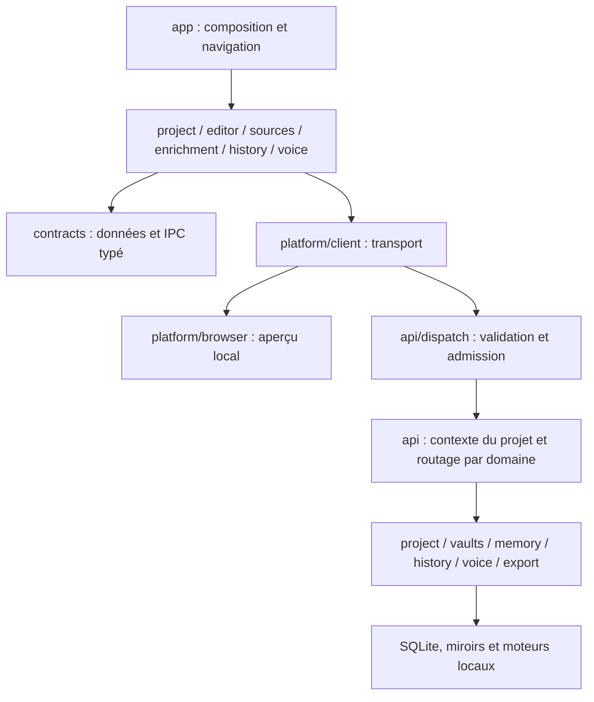

# Organisation du code

Ariane est une application macOS Tauri 2, Rust, React/TypeScript et CodeMirror 6. Elle conserve les projets localement et sépare l’écriture, les sources externes et les traitements documentaires. Ce document décrit le code après la refactorisation modulaire de novembre 2026 ; les fonctionnalités retirées restent décrites dans `annulations-2026-11-01.md`.

## Frontières des modules

Les contrats ne dépendent ni de React, ni de Tauri, ni des contrôleurs. Les fonctions métier ne dépendent pas d’`App` ou du type global `Workspace`. Les interfaces de domaine sont importées directement depuis leur propriétaire ; les anciennes façades `app/types.ts` et `app/client.ts` ont été retirées.

`npm run verify:architecture` vérifie ces frontières et la présence des mêmes 74 noms de commandes dans `Requests`, `Responses` et l’énumération Rust. Ce contrôle ne prouve pas l’équivalence de chaque champ JSON : les tests de comportement, le témoin IPC partagé et la recette native complètent le typage.

## Frontend : responsabilités et état

| Module | Responsabilité et propriétaire de l’état |
| --- | --- |
| `app/App.tsx` | Compose les domaines, relie leurs événements, conserve les états de présentation transversaux et les points d’ancrage des portails. |
| `app/chrome/` | En-tête et géométrie du panneau commun recherche/dictée. `useBottomPanel` libère son observer et son timer. |
| `app/writing/WritingSurface.tsx` | Maintient titre et éditeur dans la même `.manuscript-column`, sans conteneur supplémentaire. Versions masque cette surface sans détruire l’éditeur. |
| `app/useWorkspace.ts` | Possède navigation, sélection, session et verrous des opérations UI ; compose les contrôleurs. `WorkspaceDialogs`, `WorkspaceNotices` et `useTitleNotices` sont des adaptateurs de cette couche de composition. |
| `app/commands/useWorkspaceCommands.ts` | Registre des commandes à identifiants stables, raccourcis et abonnement au menu natif. Conserve les différences de sauvegarde/navigation entre palette et menus natifs. |
| `project/useProject.ts` | Propriétaire unique des brouillons, de la file de sauvegarde et des révisions confirmées. Un échec conserve le tampon ; un acquittement ancien ne remplace pas une édition récente. |
| `project/operations.ts` | Opérations de bibliothèque, création, métadonnées, ouverture et réorganisation ; reçoit les mêmes verrous et files que le coordinateur. Aucun deuxième état de projet. |
| `project/Binder.tsx`, `project/binder/` | Vue de bibliothèque, contrôleur de sélection/virtualisation et ligne d’arbre. Les clés restent les identifiants des sections. La création prépare le nom dans la sidebar avant validation. |
| `editor/Editor.tsx`, `editor/runtime/` | Le composant possède les refs et les effets React ; `mount` possède une instance CodeMirror et son nettoyage ; `commands` expose l’interface impérative ; `revision` actualise les marques. |
| `sources/` | Lecteurs, recherche, navigation des sources et épinglage ; `actions` gère lecture/citation, `margin/DocumentaryMargin` rend la marge documentaire. |
| `enrichment/` | Suggestions et fiches dérivées du manuscrit. Les hooks reçoivent des interfaces d’entrée explicites, pas le type global `Workspace`. Leurs contrôles de contexte et de fraîcheur restent auprès des tâches asynchrones. |
| `history/` | `useHistory` possède chargements, sélection, comparaison et restauration ; `History` rend la vue ; `HistoryTools` rend les outils dans le portail existant. |
| `voice/` | `useVoiceSession` possède acquisition, sessions, files audio, annulation et nettoyage ; `VoiceButton` rend les commandes et contenus du panneau. |
| `export/`, `revision/` | Contrôleurs et vues existants : un export continue lorsque son dialogue est fermé ; les propositions de révision restent des suggestions. |

La saisie reste gérée par les transactions CodeMirror. React ne contrôle pas le texte à chaque touche. `sectionMapping`, les identifiants de l’outline, les offsets UTF-16, l’historique d’annulation et les abstractions de défilement restent communs aux commandes et au rendu. Le changement de panneau ne doit pas reconstruire l’éditeur.

`projectSearch.ts` calcule les occurrences sur les textes courants, brouillons compris. `useUnifiedSearch` interroge les vaults séparément, avec temporisation et rejet des réponses périmées. La navigation révèle les passages repliés. Les états durables du projet et les états d’affichage restent distincts.

## Contrats et plateformes

`contracts/` contient les DTO par domaine : projet, réglages, sources, versions, mémoire, entités, annotations, notes, import et révision. `requests.ts` associe une commande à ses paramètres et son résultat : les appelants ne choisissent plus arbitrairement le type de retour de `request`.

`platform/client.ts` sélectionne le transport. Dans Tauri, il invoque toujours `dispatch` avec `{ request: { type, ...paramètres } }`. `platform/browser/client.ts` conserve les clés de stockage et les possibilités de l’aperçu navigateur. Celui-ci ne simule ni accès aux fichiers natifs, ni inférence, ni fonctions retirées. Les résultats ignorés par tous les appelants restent explicitement `unknown` lorsque leur forme diffère entre plateformes ; ils doivent être précisés avant un nouvel usage.

Les commandes, événements, formats persistés, valeurs par défaut et ressources ne changent pas avec ce découpage. Le JSON `tests/fixtures/ipc-save.json` est consommé par les tests TypeScript et Rust pour vérifier notamment révisions, caractères accentués, emoji et offsets UTF-16.

## Backend : contexte, transactions et moteurs

- `api/request.rs` définit le protocole serde ; `api/state.rs` conserve les ressources partagées. `api/dispatch.rs` valide et admet la requête avant `spawn_blocking`, puis conserve le permis jusqu’à sa fin.
- `api/mod.rs` capture le projet courant et garde le verrou OS vivant pendant l’opération. Les modules `project_commands`, `memory_commands`, `vault_commands`, `source_commands` et `version_commands` routent vers les domaines. `api/session.rs` ne publie le nouveau projet actif qu’après ouverture et sauvegarde de session réussies.
- `project/schema.rs` possède ouverture de base, schéma et sauvegarde avant migration ; `queries.rs` lit les sections ; `mutations.rs` applique les mutations élémentaires ; `mirrors.rs` réconcilie les fichiers ; `storage.rs` garde la transaction de sauvegarde, les révisions et la reprise après commit. `library.rs`, `manuscript.rs`, `annotations.rs`, `links.rs` et `catalog.rs` conservent leurs responsabilités existantes.
- `memory/passages.rs` synchronise les passages et calcule les travaux en attente ; `memory/context.rs` lit contexte, entités, passages, session et rejets ; `memory/mod.rs` conserve l’application transactionnelle des résultats et la normalisation. Les files, caches, contrôles de fraîcheur et moteurs restent séparés dans leurs modules existants.
- `vaults/` lit les dossiers externes, YAML, tags, alias et PDF. L’index FTS5 et les données dérivées restent dans une base distincte. Une source externe s’ouvre en lecture seule ; une fiche appartenant à Ariane est distincte.
- `retrieval/` distingue identité exacte, liens explicites, tags et proximité sémantique. Les résultats restent filtrés par périmètre. `inference/`, `memory_engine/` et `voice/` conservent leurs processus, priorités et protocoles ; le découpage ne modifie aucun modèle ni seuil.
- `history/` conserve les versions de texte, structure, paramètres, références et fiches. `export/` assemble et convertit avec les ressources locales existantes ; son annulation arrête le groupe de processus.
- `platform.rs` conserve les menus macOS et la demande de sauvegarde avant sortie. `app/useNativeClose.ts` partage le chemin de fermeture/quitter ; le backend attend la confirmation du frontend.

## Format de projet et invariants

Un dossier contient `ariane.sqlite`, `manuscrit/<identifiant>.md` et, si nécessaire, `recuperation/`. SQLite reste la source transactionnelle ; les Markdown sont des miroirs lisibles. La transaction est validée avant matérialisation. Une erreur de miroir ne transforme pas un commit réussi en perte des données ; la reprise, les conflits externes et les copies de récupération restent explicitement gérés.

Les sections conservent rôle, inclusion et corbeille ; le champ historique `role` reste lisible sans imposer deux arborescences. La file de sauvegarde conserve les révisions et séquence les métadonnées avant les opérations qui en dépendent. Le catalogue `library.sqlite` et la dernière session ne remplacent pas les bases propres aux projets.

`import.rs` ajoute les textes convertis au projet actif dans une transaction et ne copie que les images nécessaires. Les annotations restent indépendantes du Markdown et des exports ; une annotation ambiguë n’est pas réattachée arbitrairement. Les fonctions retirées de réorganisation, de remplacement global ou d’import ne sont pas réintroduites.

## Styles et maintenance

Les points d’entrée `styles/editor.css` et `styles/surfaces.css` importent leurs groupes de règles dans un ordre explicite. Les autres feuilles gardent leur ordre de chargement. Les règles transversales et correctives restent dans leur position de cascade : ne pas les déplacer dans un composant sans vérifier leur priorité et les vues concernées.

Pour ajouter une fonction :

1. Définir les données dans le contrat métier approprié et, si elles traversent l’IPC, dans les modèles Rust et `contracts/requests.ts`.
2. Implémenter la règle dans son domaine ; garder un propriétaire unique de son état et de ses ressources.
3. Ajouter la variante dans `api/request.rs` et son routage dans le domaine concerné, sans déplacer les contrôles d’admission ou de contexte.
4. Composer la vue dans `App` avec les seules données et commandes nécessaires. Préserver montage, focus, sélection et nettoyage.
5. Vérifier les comportements concernés puis `npm run verify` avec `RUST_TEST_THREADS=1` pour les tests de moteurs locaux. Compléter par une recette navigateur et native selon les capacités touchées.

Les règles opérationnelles et les erreurs à éviter sont consignées dans `AGENTS.md`. La taille d’un fichier appelle une revue de responsabilités, pas une multiplication automatique de wrappers. `App`, le coordinateur de session et les contrôleurs de domaine gardent volontairement les interactions dont ils possèdent l’invariant.
