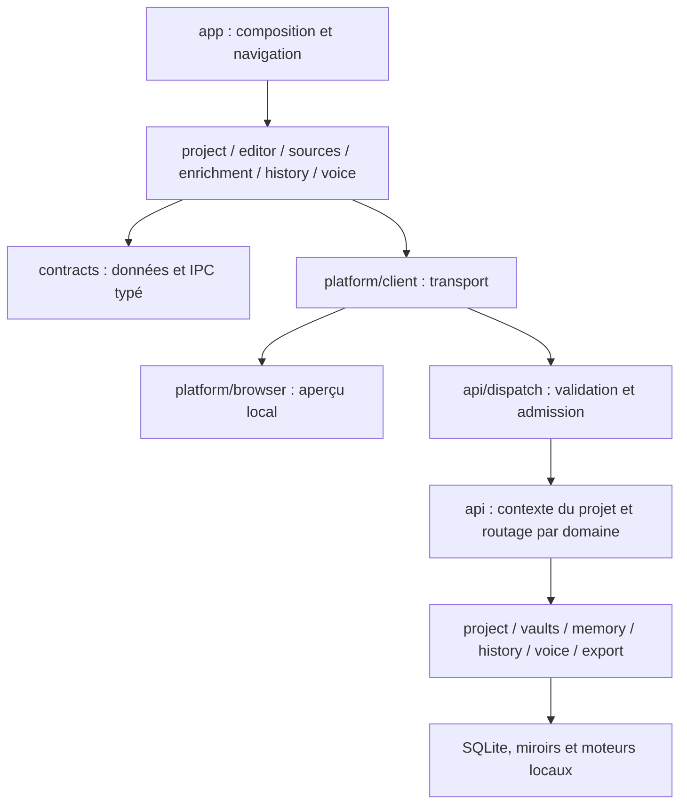
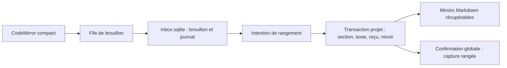

# Organisation du code

Ariane est une application macOS Tauri 2, Rust, React/TypeScript et CodeMirror 6. Elle conserve les projets localement et sépare l’écriture, les sources externes et les traitements documentaires. Ce document décrit le code après la refactorisation modulaire de novembre 2026 ; les fonctionnalités retirées restent décrites dans `annulations-2026-11-01.md`.

## Frontières des modules

Les contrats ne dépendent ni de React, ni de Tauri, ni des contrôleurs. Les fonctions métier ne dépendent pas d’`App` ou du type global `Workspace`. Les interfaces de domaine sont importées directement depuis leur propriétaire ; les anciennes façades `app/types.ts` et `app/client.ts` ont été retirées.

`npm run verify:architecture` vérifie ces frontières et la présence des mêmes 119 noms de commandes dans `Requests`, `Responses` et l’énumération Rust. Ce contrôle ne prouve pas l’équivalence de chaque champ JSON : les tests de comportement, le témoin IPC partagé et la recette native complètent le typage.

## Frontend : responsabilités et état

| Module | Responsabilité et propriétaire de l’état |
| --- | --- |
| `app/App.tsx` | Compose les domaines, relie leurs événements, conserve les états de présentation transversaux et les points d’ancrage des portails. |
| `app/chrome/` | En-tête et géométrie du panneau commun recherche/dictée. `useBottomPanel` libère son observer et son timer. |
| `app/writing/WritingSurface.tsx` | Maintient titre et éditeur dans la même `.manuscript-column`, sans conteneur supplémentaire. Versions masque cette surface sans détruire l’éditeur. |
| `app/useWorkspace.ts` | Possède navigation, sélection, session et verrous des opérations UI ; compose les contrôleurs. `WorkspaceDialogs`, `WorkspaceNotices` et `useTitleNotices` sont des adaptateurs de cette couche de composition. |
| `app/commands/useWorkspaceCommands.ts` | Registre des commandes à identifiants stables, raccourcis et abonnement au menu natif. Conserve les différences de sauvegarde/navigation entre palette et menus natifs. |
| `project/useProject.ts` | Propriétaire unique des brouillons, de la file de sauvegarde et des révisions confirmées. Un échec conserve le tampon ; un acquittement ancien ne remplace pas une édition récente. |
| `project/operations.ts` | Opérations de bibliothèque, création, métadonnées, ouverture et réorganisation ; reçoit les mêmes verrous et files que le coordinateur. Aucun deuxième état de projet. |
| `project/Binder.tsx`, `project/binder/` | Vue de bibliothèque, contrôleur de sélection/virtualisation et ligne d’arbre. Les clés restent les identifiants des sections. La création prépare le nom dans la sidebar avant validation. |
| `editor/Editor.tsx`, `editor/runtime/` | Le composant possède les refs et les effets React ; `mount` possède une instance CodeMirror et son nettoyage ; `commands` expose l’interface impérative ; `revision` actualise les marques. |
| `sources/` | Lecteurs, recherche, navigation des sources et épinglage ; `actions` gère lecture/citation, `margin/DocumentaryMargin` rend la marge documentaire. |
| `enrichment/` | Suggestions et fiches dérivées du manuscrit. Les hooks reçoivent des interfaces d’entrée explicites, pas le type global `Workspace`. Leurs contrôles de contexte et de fraîcheur restent auprès des tâches asynchrones. |
| `history/` | `useHistory` possède chargements, sélection, comparaison, variantes et restauration ; `History` rend la vue ; `HistoryTools` rend les outils dans le portail existant. `useWritingBranches` synchronise la variante active avec la capsule du titre et attend la sauvegarde avant tout changement. Les états automatiques et les brouillons des variantes restent distincts. |
| `voice/` | `useVoiceSession` possède acquisition, sessions, files audio, annulation et nettoyage ; `VoiceButton` rend les commandes et contenus du panneau. |
| `export/`, `revision/` | Contrôleurs et vues existants : un export continue lorsque son dialogue est fermé ; les propositions de révision restent des suggestions. |

La saisie reste gérée par les transactions CodeMirror. React ne contrôle pas le texte à chaque touche. `sectionMapping`, les identifiants de l’outline, les offsets UTF-16, l’historique d’annulation et les abstractions de défilement restent communs aux commandes et au rendu. Le changement de panneau ne doit pas reconstruire l’éditeur.

`projectSearch.ts` calcule les occurrences sur les textes courants, brouillons compris. `useUnifiedSearch` interroge les vaults séparément, avec temporisation et rejet des réponses périmées. La navigation révèle les passages repliés. Les états durables du projet et les états d’affichage restent distincts.

## Contrats et plateformes

`contracts/` contient les DTO par domaine : projet, réglages, sources, versions, mémoire, entités, annotations, notes, import et révision. `requests.ts` associe une commande à ses paramètres et son résultat : les appelants ne choisissent plus arbitrairement le type de retour de `request`.

`platform/client.ts` sélectionne le transport. Dans Tauri, il invoque toujours `dispatch` avec `{ request: { type, ...paramètres } }`. `platform/browser/client.ts` conserve les clés de stockage et les possibilités de l’aperçu navigateur. Celui-ci ne simule ni accès aux fichiers natifs, ni inférence, ni fonctions retirées. Les résultats ignorés par tous les appelants restent explicitement `unknown` lorsque leur forme diffère entre plateformes ; ils doivent être précisés avant un nouvel usage.

Les commandes, événements, formats persistés, valeurs par défaut et ressources ne changent pas avec ce découpage. Le JSON `tests/fixtures/ipc-save.json` est consommé par les tests TypeScript et Rust pour vérifier notamment révisions, caractères accentués, emoji et offsets UTF-16.

## Backend : contexte, transactions et moteurs

- `api/request.rs` définit le protocole serde ; `api/state.rs` conserve les ressources partagées. `api/dispatch.rs` valide et admet la requête avant `spawn_blocking`, puis conserve le permis jusqu’à sa fin.
- `api/mod.rs` capture le projet courant et garde le verrou OS vivant pendant l’opération. Les modules `project_commands`, `memory_commands`, `vault_commands`, `source_commands` et `version_commands` routent vers les domaines. `api/session.rs` ne publie le nouveau projet actif qu’après ouverture et sauvegarde de session réussies.
- `project/schema.rs` possède ouverture de base, schéma et sauvegarde avant migration ; `queries.rs` lit les sections ; `mutations.rs` applique les mutations élémentaires ; `mirrors.rs` réconcilie les fichiers ; `storage.rs` garde la transaction de sauvegarde, les révisions et la reprise après commit. `library.rs`, `manuscript.rs`, `annotations.rs`, `links.rs` et `catalog.rs` conservent leurs responsabilités existantes.
- `memory/passages.rs` synchronise les passages par scène et calcule les travaux en attente. La signature de synchronisation regroupe révision, miroir, outline et titre, avec une nouvelle lecture sous verrou d’écriture lorsqu’une mise à jour est nécessaire. `memory/inline.rs` livre les mentions du projet sur une connexion et un catalogue de sources communs. `memory/results.rs` contrôle la fraîcheur du catalogue avant et après les écritures groupées du cache. `memory/context.rs` lit contexte, entités, passages, session et rejets. `memory/mod.rs` conserve l’application transactionnelle des résultats et la normalisation. Les files et priorités des moteurs gardent leurs propriétaires. [Mesures de la 0.7.5](optimisation-entites-0.7.5.md)
- `vaults/` lit les dossiers externes, YAML, tags, alias et PDF. L’index FTS5 et les données dérivées restent dans une base distincte. Une source externe s’ouvre en lecture seule ; une fiche appartenant à Ariane est distincte.
- `retrieval/` distingue identité exacte, liens explicites, tags et proximité sémantique. Les résultats restent filtrés par périmètre. `inference/`, `memory_engine/` et `voice/` conservent leurs processus, priorités et protocoles ; le découpage ne modifie aucun modèle ni seuil.
- `history/` conserve les versions de texte, structure, paramètres, références et annotations. Les variantes et leurs brouillons sont stockés dans SQLite ; la relecture compare une origine commune et conserve des points de retour avant intégration ou restauration. `export/` assemble et convertit avec les ressources locales existantes ; son annulation arrête le groupe de processus.
- `platform.rs` conserve les menus macOS et la demande de sauvegarde avant sortie. `app/useNativeClose.ts` partage le chemin de fermeture/quitter ; le backend attend la confirmation du frontend.

## Format de projet et invariants

Un dossier contient `ariane.sqlite`, `manuscrit/<identifiant>.md` et, si nécessaire, `recuperation/`. SQLite reste la source transactionnelle ; les Markdown sont des miroirs lisibles. La transaction est validée avant matérialisation. Une erreur de miroir ne transforme pas un commit réussi en perte des données ; la reprise, les conflits externes et les copies de récupération restent explicitement gérés.

Le schéma des versions passe à 2 avec une copie SQLite préalable dans `recuperation/`. Les origines, brouillons et parents de variantes sont stockés localement ; le journal d’activité des notes reste indépendant des restaurations. Les limites et exceptions des sauvegardes automatiques sont décrites dans [Versions et variantes d’écriture](versionnement-ecriture.md).

Les sections conservent rôle, inclusion et corbeille ; le champ historique `role` reste lisible sans imposer deux arborescences. La file de sauvegarde conserve les révisions et séquence les métadonnées avant les opérations qui en dépendent. Le catalogue `library.sqlite` et la dernière session ne remplacent pas les bases propres aux projets.

`import.rs` ajoute les textes convertis au projet actif dans une transaction et ne copie que les images nécessaires. Les annotations restent indépendantes du Markdown et des exports ; une annotation ambiguë n’est pas réattachée arbitrairement. Les fonctions retirées de réorganisation, de remplacement global ou d’import ne sont pas réintroduites.

## Styles et maintenance

Les points d’entrée `styles/editor.css` et `styles/surfaces.css` importent leurs groupes de règles dans un ordre explicite. Les autres feuilles gardent leur ordre de chargement. Les règles transversales et correctives restent dans leur position de cascade : ne pas les déplacer dans un composant sans vérifier leur priorité et les vues concernées.

La marge documentaire affiche le titre dans la couleur du type de source. Le survol et le focus clavier révèlent le type, le motif du rapprochement et la description ou un extrait disponible sur un fond teinté. L’aperçu et la fiche ouverte partagent le rayon `--suggestion-card-radius`, y compris pendant l’animation d’ouverture. Les suggestions issues du manuscrit reprennent la même présentation avec leur contexte. `DocumentaryMargin` mesure les groupes dépliés pour que `marginLayout` conserve les ancrages et réserve la place nécessaire aux mentions suivantes.

Pour ajouter une fonction :

1. Définir les données dans le contrat métier approprié et, si elles traversent l’IPC, dans les modèles Rust et `contracts/requests.ts`.
2. Implémenter la règle dans son domaine ; garder un propriétaire unique de son état et de ses ressources.
3. Ajouter la variante dans `api/request.rs` et son routage dans le domaine concerné, sans déplacer les contrôles d’admission ou de contexte.
4. Composer la vue dans `App` avec les seules données et commandes nécessaires. Préserver montage, focus, sélection et nettoyage.
5. Vérifier les comportements concernés puis `npm run verify` avec `RUST_TEST_THREADS=1` pour les tests de moteurs locaux. Compléter par une recette navigateur et native selon les capacités touchées.

Les règles opérationnelles et les erreurs à éviter sont consignées dans `AGENTS.md`. La taille d’un fichier appelle une revue de responsabilités, pas une multiplication automatique de wrappers. `App`, le coordinateur de session et les contrôleurs de domaine gardent volontairement les interactions dont ils possèdent l’invariant.

## Activité des notes et chrome natif

Les ajouts fonctionnels qui suivent la refactorisation sont distincts des extractions mécaniques :

- `notes/useNoteActivity` possède le journal affiché, les écritures en attente, leur reprise et la pagination. Les événements automatiques possèdent une clé stable par contexte ; les actions explicites ont une clé unique pour rester répétables et pour que leur réessai soit idempotent. Les changements de projet et la fermeture attendent les écritures en attente.
- `notes/useNoteObservations` observe les détections et suggestions affichées ainsi que les ouvertures de cartes et de lecteurs. Les créations, classements, résolutions, associations, citations, épinglages et modifications sont signalés après succès par leurs contrôleurs. Une consultation enregistrée indique l’ouverture du lecteur, sans prétendre que le contenu a été lu intégralement.
- `project/activity.rs` conserve ces événements dans la table additive `note_activity` du SQLite du projet. Le journal garde les métadonnées (type, titre, identifiants, date), sans copie du corps du manuscrit. Il n’est pas rétroactif et n’est pas effacé par une restauration de version. L’adaptateur navigateur utilise son stockage local distinct.
- Le panneau « Historique » charge le journal par pages de 50 et permet de rouvrir les sources. `app/chrome/HistoryEdge` remplace l’ancien bouton supérieur « Reprendre le fil » : le bord droit affiche son chevron et une infobulle à l’approche du pointeur, puis le clic ouvre ou ferme le panneau, initialement replié. Il réutilise le suivi du pointeur et les infobulles de la sidebar. `useMemory` conserve l’état d’ouverture ; `MemoryReader` garde son contenu, son placement et le retour du focus à la fermeture. L’accès au bord est masqué en Versions et en focus immersif. Les événements persistés alimentent les notifications brèves de `useTitleNotices` ; le rechargement de l’historique ne les rejoue pas. La capsule affiche la requête de sauvegarde pendant son exécution et signale les erreurs. La frappe et la confirmation automatique de la sauvegarde sont silencieuses. L’actualisation des liens, l’indexation et l’ouverture des surfaces utilisent aussi cette capsule, avec leurs actions dans les détails. Les anciens états et bandeaux de notification du bas sont retirés.
- En focus immersif, le titre de la section reste visible dans la même colonne que le manuscrit, tandis que ses smart-tags sont masqués ; l’entrée et la sortie du mode rendent le focus à l’éditeur.
- `DepthControl` garde son déploiement horizontal sur grand écran. À 1 100 px et moins, seul le slider devient un panneau positionné au-dessus du bouton ; le bouton reste ancré.
- `components/WindowDragRegion` ajoute une surface transparente sous les commandes de la barre supérieure, sur l’accueil et l’espace d’écriture. Elle appelle explicitement `startDragging()` de [Tauri](https://v2.tauri.app/learn/window-customization/) sur un clic gauche et utilise l’autorisation native existante. Les échecs rejoignent la capsule supérieure. Les commandes et le menu du titre restent au-dessus de cette surface.

## Smart-tags — 0.4.0

`contracts/smartTags.ts` et les modèles Rust définissent les identités, définitions et opérations. `tags/model.ts` calcule l’union des affectations directes et des ancêtres, indépendamment des tags des sources. `project/tags.rs` administre les définitions du projet et remappe les références dans une transaction ; une version précède les modifications des tags existants. Le schéma SQLite 3 ajoute les affectations de sections et les définitions ; la migration sauvegarde d’abord la base et tolère une colonne déjà présente. Les affectations de passages sont sérialisées dans les nœuds de l’outline. Les snapshots et brouillons de variantes incluent définitions et affectations.

`editor/tagInput.ts` reconnaît `#nom`, propose les tags existants et crée ou réutilise automatiquement une définition à la fin du mot. Les tâches capturent le nœud et remappent leur plage pendant la frappe ; elles ne remplacent jamais une saisie supprimée ou un autre projet. `useProject` suit ces tâches dans sa sauvegarde unique et demande la validation du dernier tag avant un checkpoint de transition. La création ne force ni retour à la ligne ni déplacement du curseur en cours de frappe. Les métadonnées passent par les transactions et l’historique CodeMirror.

`editor/smartTags.ts` présente les libellés à la fin des passages. Il masque les répétitions d’un tag présent sur un ancêtre d’outline sans modifier les données ; `outline/view.ts` colore les points avec tous les tags effectifs, y compris hérités. La sélection Maj-clic inclut les branches repliées ; le marqueur qui suit une branche repliée cible sa ligne visible.

`tags/TagManager.tsx` utilise désormais la page centrale partagée et s’ouvre depuis la sidebar. `tags/passages.ts` projette les originaux correspondant à un tag et à son héritage ; `TagFilterView` les rend en consultation dans la colonne du manuscrit. L’éditeur original reste monté, caché et en lecture seule pendant ce filtre ; les outils globaux restent visibles et le filtre dispose de ses commandes de présentation. Cliquer sur un passage rejoint l’original. Ce parcours simple a été avancé depuis le jalon 0.5.0 sur demande de l’utilisateur ; le parseur combiné et les vues enregistrées sont implémentés depuis la 0.5.0 (voir ci-dessous).

`project/outline.rs` conserve les identités et tags utiles lors des scissions/réunions de scènes ; un bloc coupé reçoit un second identifiant et transmet ses tags aux fragments. Cette évolution du jalon 0.4.0 est distincte des anciennes opérations annulées et ne réintroduit ni déplacement de sélection vers une scène, ni simulation navigateur des opérations natives.

`contracts/lineProperties.ts` définit les champs typés, valeurs et références source/ligne. Les schémas des champs appartiennent aux tags, les valeurs directes et conflits aux nœuds JSON ; aucune entité « Relation » n’est créée. `tags/properties.ts` résout valeurs directes, mentions compatibles, ancêtres puis défauts. Une détection n’alimente que les liens configurés par type, avec un `sourceId` non ambigu et un texte courant ; elle ne déduit pas une relation sémantique. Les valeurs saisies, y compris null, restent prioritaires. Les conflits de réunion sont conservés et présentés au lieu d’être écrasés. Les scissions détachant une racine conservent ses valeurs héritables.

`tags/OutlineDetails` présente ces champs dans la marge droite. `outline/view` distingue le chevron de pliage du point de détail/déplacement. Les commandes de propriétés et de tags des passages passent par les transactions CodeMirror et leur inversion. `DocumentTitle` garde son brouillon et délègue les conversions asynchrones à `tags/useTitleTagInput` ; les plages sont remappées et une saisie supprimée n’est pas remplacée. Les affectations de titre utilisent la file des métadonnées de `useProject`, ne remplacent pas les brouillons et ne remontent pas CodeMirror. Les flushers du titre et du manuscrit sont enregistrés ensemble pour les transitions.

`tags/table.ts` construit les lignes et colonnes de la projection globale. `TagFilterView` alterne texte et `TagPassageTable` ; sa largeur dépend des colonnes et de l’espace disponible, avec débordement horizontal local. Le compteur mesure les originaux filtrés ; le footer et la recherche restent présents, le bouton « Aa » devient le changement de vue et la profondeur est désactivée. Les propriétés restent modifiables dans le détail, et sont consultables dans le tableau. Les suppressions de puces retirent uniquement l’affectation explicite d’origine ; les retraits successifs lisent les références courantes pour ne pas rétablir un tag retiré. Le manuscrit masqué reste en lecture seule, y compris pour une insertion de dictée tardive.

`ViewTitleCapsule` est un emplacement de présentation partagé avec l’accueil et les vues. Le titre suit uniquement la vue principale : document, filtre de tag, Versions, ou page comme Paramètres et Smart-tags. Dans un projet, ces pages utilisent la capsule unique du cadre d’ariane ; sans projet, `WorkspaceScreen` conserve la présentation autonome et sa capsule. Ouvrir un menu, un dialogue, la recherche, la dictée ou une marge (historique, détail, lecteur, annotations) conserve le titre de la vue courante. L’accueil conserve aussi son titre pendant les dialogues de création et d’ouverture. `useTitleNotices` conserve la propriété unique des notifications, actions et détails. `PathMenu` masque le nom et l’icône de branche pendant les notifications et lorsqu’aucune variante n’existe ; il reprend le contexte de la vue ensuite. Les identifiants des menus restent propres à chaque instance. Dans un projet, la surface de glissement native demeure dans le cadre permanent, sous les contrôles. La présentation autonome conserve sa propre surface.

Les relations vers des lignes se résolvent d’abord par leur identifiant stable ; si une scission a changé la scène, la navigation retrouve son nouvel emplacement. Une référence absente ou ambiguë n’est pas remplacée par une correspondance supposée.

## Accès du projet sans ouvrir la sidebar

Le classeur ouvert forme un panneau arrondi en retrait du haut et du bord gauche. Sur macOS, ce retrait et le rayon du coin supérieur gauche sont réduits pour que les boutons système restent sur le fond du panneau. Le logo est centré dans le panneau. Les boutons Profil et Paramètres occupent deux colonnes de même largeur au pied du panneau. Le panneau et la capsule d’accès en dessous partagent `--sidebar-panel-width`. La largeur réservée dans l’espace d’écriture reste `--sidebar-width`.

`SidebarDock` possède le déploiement temporaire de la capsule, indépendant de l’état de la sidebar : survol maintenu de 500 ms sur le thème, fermeture après une sortie de 150 ms, maintien pendant le focus clavier, Échap et retour du focus au thème. Les timers sont annulés au démontage, pendant une opération occupée et lors d’un changement d’état de la sidebar. Le bouton de thème garde ses coordonnées lors du déploiement autonome.

Les actions partagées sont rendues par `project/BinderActions` : thème et quatre accès dans la capsule, profil et paramètres répartis sur une ligne lisible au-dessus lorsque la sidebar est ouverte. Ces deux derniers accès sont masqués, y compris au clavier, lorsque la sidebar est repliée ; son déploiement temporaire ne révèle que la capsule. La vue active est indiquée par `aria-current`. L’application les conserve dans le dock sans monter `Binder` ; le classeur réutilise le même composant lorsqu’il est utilisé seul. Le clic sur une action referme la capsule temporaire. Corbeille ouvre explicitement le classeur dans cette vue ; les préférences `libraryView` restent synchronisées avec la vue visible lorsque la création ou la révélation ramène aux textes. Le simple survol ne modifie ni la sélection, ni le défilement, ni la visibilité de la sidebar.

## Identités, requêtes et commandes — 0.5.0

`contracts/entityIdentity.ts` sépare identité durable, fiche, source et détection. `project/entities.rs` possède le catalogue transactionnel (`meta.entity_catalog`) et le journal `entity_merges` ; le schéma projet 4 ajoute ce journal après sauvegarde cohérente. Les redirections suivent les IDs ; le nom ne sert pas de clé. Confirmation et provenance des relations restent indépendantes. Les snapshots incluent le catalogue ; le remplacement d’espace de travail conserve une révision monotone et les réunions comparent identités et relations comme métadonnées distinctes. Les vues enregistrées (`project/saved_views.rs`) restent des préférences du projet, hors restauration de texte.

`vaults/cards.rs` vérifie appartenance au vault ariane, chemins et empreintes avant l’écriture. Une intention durable dans `card_edits` contient états avant/après ; le remplacement de fichier est atomique, l’index est reconstructible et la récupération refuse d’écraser un changement concurrent. L’édition des alias et celle des fiches partagent le verrou d’opérations du projet. Aucun de ces mécanismes n’autorise une écriture dans un vault externe. Modifier une identité ne réécrit pas les phrases ni les fichiers des fiches ; leur édition est explicite.

`entities/useEntityManager` possède les chargements et mutations du gestionnaire, vérifie le contexte projet et ignore les réponses remplacées. `entities/occurrences` réunit mentions résolues par ID, références explicites et noms non ambigus ; les lots dont le texte ne correspond plus sont ignorés. Le détail des relations utilise ce contrôleur, sans recevoir le Workspace global. La liste de sources est un aperçu : l’édition charge toujours `source` avant de présenter le corps complet.

`search/query.ts` analyse la syntaxe ; `resolveQuery.ts` résout les noms en IDs ; `evaluateQuery.ts` calcule une union d’intersections de passages courants. Ces fonctions ne dépendent pas de React/Tauri. Les vues structurées partagent `TagFilterView` et sa projection texte/tableau, en conservant l’éditeur monté et en lecture seule. Les analyses manquantes et ambiguïtés sont explicites. Les expressions enregistrées portent une version de format indépendante de celle de l’application.

`contracts/commands.ts` et `app/commands/registry.ts` décrivent IDs, portées et combinaisons par défaut. `shortcuts.ts` conserve les préférences locales et synchronise les accélérateurs ; `useWorkspaceCommands` conserve les actions et leurs différences de flush/checkpoint. Le clavier de l’application intercepte ses commandes avant CodeMirror ; les événements de menu correspondants sont dédoublonnés. Les commandes auparavant propres aux menus gardent leur chemin natif. Les champs d’enregistrement suspendent ces accélérateurs et les rétablissent à la sortie. Les keymaps et l’instance CodeMirror ne sont pas recréées pour changer une combinaison. Le format persistant est `ariane.shortcuts.v1` ; ce stockage reste celui des raccourcis applicatifs. Depuis la 0.6.0, la combinaison globale de capture appartient à la base de réception et à l’enregistrement natif décrit ci-dessous.

## Capture rapide — 0.6.0

`main.tsx` charge soit `App`, soit `CaptureApp` pour la webview `capture`. La compacte ne monte ni Workspace, ni indexeurs, ni moteur voix. `api/dispatch.rs` vérifie le label natif et limite cette fenêtre aux commandes de brouillon, de lecture des réglages et de cycle de vie. Les dialogues de fichiers et les écritures projet restent dans `main`.

`CaptureDraft` possède la file, les générations locales, la révision confirmée et les identifiants de réessai. CodeMirror possède le document et l’annulation. Un timer fixe de 200 ms déclenche la sauvegarde pendant la frappe ; ce délai de déclenchement ne garantit pas le temps du commit. Une réponse perdue garde son identifiant, puis la file publie l’édition plus récente. La finalisation bloque les nouvelles frappes jusqu’à confirmation du brouillon suivant. Le masquage conserve l’instance et son historique ; la relance restaure texte et sélection UTF-16.

`inbox::Service` conserve un verrou OS sur le profil et sérialise seulement les opérations de réception. `inbox.sqlite`, schéma indépendant **1**, contient captures, préférences, reçus d’opérations et intentions de rangement. Les reçus de frappe gardent l’empreinte d’entrée et les métadonnées de réponse ; le texte fourni et vérifié sert à rejouer la réponse sans stocker une copie intégrale à chaque frappe. Les événements `inbox-changed` contiennent nature, ID et révision après commit ; seuls les changements utiles font recharger listes et réglages. La voie IPC de sauvegarde reste séparée des tâches lourdes et du contrôle des fenêtres.

Le schéma projet **5** ajoute `project_id` et `capture_receipts`, après copie cohérente de la base précédente. Ces métadonnées restent hors des snapshots du manuscrit et des variantes. Le rangement réserve une destination durable dans la réception, vérifie projet/piste, puis insère section entière, texte, reçu et `mirror_pending` dans une transaction projet. Il tente ensuite les miroirs existants et confirme la réception. Une réponse perdue retrouve le reçu exact : elle n’écrase ni une édition ultérieure, ni une suppression, ni une restauration de version. Le projet actif doit être ouvert explicitement ; une intention sans reçu ne provoque aucune écriture automatique au démarrage. L’original reste consultable dans les captures rangées. Les miroirs en erreur restent distincts du commit du texte.

`capture_window.rs` possède fenêtre réutilisée, application précédente et raccourci global. Sur macOS, les adaptations AppKit restent sur le thread principal et concernent seulement Spaces/plein écran et retour de focus. Le choix de l’écran part du pointeur, puis de l’écran principal en secours ; la taille est bornée à sa zone de travail. Le raccourci persiste dans SQLite ; `ariane.shortcuts.v1` conserve l’autorité des autres commandes. Pendant l’enregistrement d’une combinaison, les accélérateurs natifs et globaux sont suspendus. Une inscription refusée conserve l’ancienne combinaison.

`app_lifecycle.rs` attribue un ID aux fermetures, restaurations et sorties. Chaque webview, même cachée ou en cours de chargement, doit acquitter sa file. `useWindowLifecycle` suspend les entrées, attend les propriétaires de ressources (dont la fin de session audio), puis le checkpoint et la session. Une erreur ou expiration maintient l’app ouverte et remonte dans la capsule. Fermer une fenêtre la masque ; Quitter arrête le processus après les deux acquittements. Une restauration garde les mutations suspendues jusqu’à la fin du traitement.

La sauvegarde globale est une copie SQLite cohérente avec manifeste `ariane-captures`, format **1**, dans `meta.backup_manifest`. La restauration valide schéma, intégrité, captures et réglages, crée `avant-restauration-<id>.sqlite`, puis fusionne transactionnellement. Un brouillon récent est conservé ; une divergence de texte devient une note distincte à ID stable, donc un second essai ne la duplique pas. Intentions et reçus globaux sont conservés sans rouvrir de projet. Les projets et vaults externes ne font pas partie de cette sauvegarde.

Le volume global multiplie les gains historiques. `typewriterInput.ts` partage les règles de frappe ; le son est déclenché avant les raccourcis CodeMirror, reste silencieux pour IME/lecture seule/collage, et ses sources sont arrêtées au silence ou au masquage. Les préférences compactes ne modifient pas les booléens des projets. La qualification matérielle détaillée est dans `validation-0.6.0.md`.

Les archives globales sont exportées en mode journal DELETE après checkpoint : un seul fichier suffit au transport. La restauration garde une transaction de lecture sur l’archive, vérifie les entrées puis les fusionne en parcourant les lignes ; la taille cumulée de la réception n’est pas limitée artificiellement à 256 Mio. Chaque valeur sérialisée est bornée à 16 Mio et chaque capture à 2 Mio. Ces bornes ne constituent pas une mesure d’endurance.

## Profil d’écriture

`profile/WriterProfile.tsx` utilise `WorkspaceScreen` depuis la surface `profile`, accessible à côté des paramètres au-dessus de la capsule de sidebar. Le manuscrit reste monté dans sa zone masquée et en lecture seule ; fermeture et retour suivent la restauration de focus commune. Le nom de plume et la présentation sont facultatifs et stockés localement sous `ariane.writer-profile.v1`, indépendamment des projets, sans compte distant. Une écriture refusée conserve le formulaire et remonte l’erreur dans la capsule globale.

`profile/model.ts` calcule un aperçu du projet courant avec `manuscriptSections` et le compteur de mots de l’éditeur. Les scènes exclues ou à la corbeille ne contribuent pas. La progression additionne les objectifs positifs des scènes incluses et borne la contribution de chaque scène à son objectif ; elle ne constitue pas un suivi quotidien. L’aperçu ne modifie ni les textes ni les objectifs. Le calendrier possède des agrégats quotidiens distincts, décrits ci-dessous. Les accès Versions, projets et paramètres réutilisent la navigation existante.

### Calendrier d’activité d’écriture

`profile/ActivityCalendar` affiche une année de jours locaux, en semaines du lundi au dimanche, avec sélection au clic et navigation par flèches. Le suivi commence à la première ouverture de cette version ; les dates précédentes sont inconnues et les dates futures distinctes des jours suivis sans écriture. Il agrège l’écriture de tous les projets de la fenêtre principale, y compris les textes hors manuscrit. Les captures rapides sont hors de ce périmètre.

Le listener CodeMirror de `editor/runtime/mount` émet `onWritingEdit` uniquement pour un changement de document. `editor/writingDelta` compte les mots des lignes touchées avant/après, selon la règle `\S+` du compteur existant ; les plages communes sont fusionnées. Les changements de sélection, d’outline et de géométrie ne créent pas d’activité. Le montage depuis un projet, un import ou une restauration ne rejoue pas d’édition. Collage, dictée et commandes explicites d’insertion dans l’éditeur contribuent au même total. Annuler/rétablir appliquent leur delta ; une réécriture sans variation reste un jour actif. Le total affiché par jour est `max(0, somme des deltas du jour)` : ce sont des ajouts nets, pas un nombre brut de mots tapés. Les suppressions d’un jour ultérieur ne réécrivent pas les jours passés.

`useWorkspace` possède un seul `WritingActivityStore` via `useWritingActivity`. Ce journal de profil, indépendant des bases projet, conserve seulement la date de début, les dates locales, deltas nets et nombres d’éditions sous `ariane.writing-activity.v1` dans le stockage local de la webview principale. Il ne conserve aucun texte ou chemin de projet. Un délai fixe de 500 ms persiste aussi pendant une frappe continue ; masquage, fermeture navigateur, démontage et le registre de flush natif vident ce tampon. Une panne avant cette écriture peut perdre au plus les dernières éditions non persistées ; ce journal ne constitue pas la sauvegarde transactionnelle du manuscrit et n’est pas inclus dans les archives SQLite. Une erreur conserve les comptes en mémoire ; un réessai écrit le même total et ne le double pas. Une lecture invalide bloque l’écrasement du journal et remonte une erreur dans la capsule globale. Le calendrier n’offre ni synchronisation multi-appareils ni fusion de plusieurs onglets navigateur concurrents.

## Pages intégrées et rythme d’interface

`App` possède une zone centrale `workspace-page-layout`, masquée en écriture, et le point de retour du focus. `WorkspaceScreenHost` fournit uniquement cette cible de portail, le retour de focus et le signal d’occupation. `WorkspaceScreen` y rend une section nommée pour Profil, Paramètres, réception, Smart-tags et entités. Ces sections ne sont pas des dialogues modaux et ne recréent ni le logo, ni la sidebar, ni les accès, ni la capsule du titre. Les états de page sont exclusifs avec la réception. En dehors d’un projet, la réception garde une présentation autonome avec les contrôles natifs existants.

Le main d’écriture reste monté, masqué et inerte pendant une page, de même que le groupe des outils et lecteurs. L’éditeur devient en lecture seule ; ses transactions, sa sélection, son défilement et son annulation sont conservés. Les panneaux et leurs traitements ne sont pas démontés pour cacher leur présentation. La sélection d’un texte depuis le cadre rejoint l’écriture. Un passage entre pages garde un unique retour de focus ; Échap depuis la page ferme celle-ci, sans intercepter une liste déroulante ou un dialogue enfant. Les champs d’enregistrement de raccourcis gardent la main sur les combinaisons. Une page occupée verrouille les accès et commandes transversales jusqu’à la fin de l’opération, notamment le rangement de captures et les opérations de tags.

`WorkspacePageHeading` est commun à ces pages et à Versions, qui reste dans le main d’écriture avec ses outils contextuels. `styles/workspace-pages.css` applique les espacements de `styles/tokens.css`, la mesure centrale de 1280 px et des grilles adaptées au contenu : deux groupes de réglages, catalogue/détail pour tags et captures, comparaison dans Versions. Les notifications restent dans la capsule globale. `useChromeObstructions` suit aussi les contenus de page pendant le défilement. `DESIGN.md` décrit ce rythme commun ; il ne remplace pas les contrats métier.

## Prédiction du prochain mot

Le service Rust `prediction` déduit un mot des deux mots précédents ou du mot précédent. Il associe une petite base FR/EN/ES à des comptes conservés dans `prediction.sqlite` sous le profil local. Chaque contribution porte une identité de projet, de scène, de langue, une empreinte de texte et une révision. La mise à jour d’un texte remplace sa contribution. Le service retire les scènes supprimées ou exclues. Les propositions non adoptées fournissent uniquement un retour de classement sous forme de jeton opaque.

Le projet actif est prioritaire. Le profil commun retient les transitions attestées dans au moins deux projets. La compacte utilise ce profil commun grâce à des requêtes IPC qui refusent tout chemin de projet. Les noms et alias issus du lexique des fiches autorisées éclairent la prédiction dans le projet actif. Une proposition expirée cesse de s’afficher si le document, la sélection, la langue ou le profil a changé.

L’indexation suit les écritures confirmées via un worker indépendant. Le client attend une pause de 145 ms après la frappe éligible. L’extension CodeMirror pose un widget textuel dans la ligne et applique une transaction annulable à l’acceptation. Entrée accepte la suggestion visible. La touche reprend le comportement ordinaire lorsque l’éditeur ne contient aucune proposition. Les complétions de notes actives et la composition IME suspendent l’affichage.

## Sauvegarde de projet et installation des modules

`project/backup.rs` copie la base avec l’API de sauvegarde SQLite sous le verrou d’opération et enregistre les empreintes des fichiers possédés dans un inventaire. La restauration contrôle les empreintes et la base avant de rendre la copie disponible dans un nouveau dossier. Le vault possédé est rattaché à la copie avec ses identifiants. Son index dérivé est isolé afin de permettre l’ouverture alternée des deux projets. Le stockage global des captures dispose d’un parcours indépendant.

`vaults/access.rs` enregistre les consentements dans le profil d’Ariane, en dehors des bases de projet et de leurs sauvegardes. Un consentement lie l’identité locale de la base, l’identifiant du vault, son chemin canonique et l’identité du dossier sélectionné. L’application consomme le choix du dialogue macOS une fois. Un vault externe en attente reste visible dans les réglages de sources. Son contenu, y compris les entrées d’un éventuel index partagé, est écarté de la recherche, de la lecture et de l’indexation. La capsule signale l’autorisation à l’ouverture. Le vault possédé continue à s’appuyer sur le dossier interne vérifié.

Une reconnexion garde l’identifiant du vault et le périmètre de dossiers. Un nouvel emplacement utilise un index isolé, ce qui conserve les références relatives et empêche deux projets de partager les données dérivées de dossiers différents. Une copie reçue ou restaurée a sa propre identité locale. Les références des projets antérieurs demandent un choix unique, puis le consentement est durable sur ce profil. SQLite embarqué passe à 3.54.1. Le schéma 6 des projets, le schéma 1 des captures et les formats de sauvegarde conservent leurs versions.

`runtime_install.rs` propose les installateurs existants dans les paramètres natifs. Il télécharge une version épinglée d’uv, contrôle l’empreinte de l’archive, puis lance l’installateur dans un répertoire temporaire. Le module est publié après sa vérification. Le bouton d’interruption arrête le groupe de processus. L’admission IPC de ces travaux est distincte des sauvegardes et de la prédiction.

## Repères d’écriture — 0.7.1

`editor/writingAids.ts` conserve les repères du manuscrit dans un champ CodeMirror. Une transaction de texte peut insérer ou retirer le repère en même temps que le texte. Son inverse restaure les deux. Dans le bundle macOS, Annuler et Rétablir sont routés vers la webview active. Le manuscrit et la capture utilisent leur historique CodeMirror respectif. Les champs d’édition ordinaires conservent l’annulation du navigateur. L’aperçu d’un essai est une décoration du document courant. Le brouillon privé est sauvegardé par la file existante, indépendamment du nombre de mots et des transactions d’écriture du manuscrit. Tant que l’essai reste ouvert, les exports, l’index de prédiction et le Markdown lisent la formulation d’origine. Le bouton d’adoption vérifie le passage courant avant la transaction.

Le schéma de projet passe de 5 à 6. La migration crée une copie SQLite sous `recuperation/` puis ajoute la colonne `sections.writing_aids`. Chaque repère possède une identité, le passage attendu et un décalage UTF-16. Le texte et ses repères partagent la révision de scène et le commit SQLite. Les historiques, variantes et sauvegardes de projet emportent ces métadonnées. Les anciens instantanés chargent une liste vide. Le signe `[…]` appartient au texte et reste dans le miroir et les exports. L’indice et la formulation d’essai appartiennent à la base du projet.

Les décalages suivent les transactions et les déplacements explicites de blocs, ainsi que les scissions et réunions de scènes. Une modification qui efface ou recouvre le passage conserve son contenu privé sous un repère à rattacher. Lors d’un changement externe ou d’une intégration de variantes, une position dont la provenance ne correspond plus au texte devient également détachée. Le rattachement part d’une sélection de l’auteur. L’ordre des blancs utilise les textes inclus, dans l’ordre du classeur. Un blanc littéral est accessible même sans indice.

`nearbyRepetitions` travaille sur le paragraphe sélectionné et ses deux voisins dans la même scène. Les marques transitoires suivent la sélection selon les règles de normalisation de la recherche. Elles sont retirées par Échap, une édition du texte ou la fermeture de l’éditeur.

## Alignement et aperçu de scission — 0.7.2

`history/ComparisonRows` conserve les rangées du diff de paragraphes et les actions de reprise. `usePhraseAlignment` retrouve une sélection exacte et unique dans les deux rendus, y compris à travers les marques Markdown. Il mesure les positions des plages après le rendu et ajoute l’espace nécessaire à la colonne la plus haute. Un passage déplacé peut grouper plusieurs rangées le temps de l’alignement. Sur une fenêtre étroite, la rangée alignée retrouve une disposition côte à côte. Une phrase absente ou répétée ne modifie ni la disposition ni le défilement. L’alignement est recalculé si la largeur change et expire au changement de texte, de version ou de mode Source/Lecture.

Sur Mac, la palette capture la scène, son texte, le contexte d’écriture et le curseur UTF-16 avant de donner le focus à la recherche. L’option **Scinder la scène** affiche les extraits de part et d’autre de cette position. La validation repasse par la file et l’opération native en place, après contrôle du contexte avant et après le point de reprise. La navigation, la prévisualisation et Échap se limitent à l’interface. Le schéma SQLite et le contrat IPC restent identiques.

## Lecteur documentaire et références sous la ligne · 0.8.0

La vue partagée conserve l’éditeur monté et réserve la partie droite aux PDF et images. `sources/DocumentViewer.tsx` possède la page, le zoom et la sélection documentaire. `DocumentPage.tsx` lit le PDF par plages de 4 Mio, puis confie les octets à PDF.js embarqué. Seule la page consultée est rendue. Le canevas, la couche de texte et les rectangles utilisent la même orientation intrinsèque. La fermeture annule les lectures et détruit le document et son worker. Les ressources de rendu sont embarquées par Vite. Le helper PDFKit continue d’alimenter l’index texte.

`sourceFile` accepte l’empreinte attendue du scan. Le backend vérifie le contenu sur le descripteur ouvert, puis contrôle l’identité, la taille et la date de changement du fichier pendant le service des plages. Le jeton garde les contrôles de projet et de périmètre du vault. L’enregistrement d’un lien vérifie aussi les droits et l’empreinte du document. Une copie restaurée conserve les annotations et doit obtenir un nouveau consentement local pour ouvrir un fichier externe.

Le schéma projet **7** protège le champ facultatif `document` du JSON d’annotation. La cible documentaire v1 contient l’ID du vault et de la source, le chemin relatif, l’empreinte complète, la page à partir de 1, les rectangles, la citation et ses contextes. Chaque rectangle contient les coordonnées gauche, haut, droite et bas dans [0, 1], depuis le coin supérieur gauche du contenu orienté. Les annotations antérieures gardent leur forme. La migration crée une copie dans `recuperation/`. Le schéma des captures reste indépendant. Les variantes, Versions et la sauvegarde de projet emportent la cible avec la note. Le rattachement à une nouvelle source requiert une sélection et une confirmation.

La lecture d’une note Markdown utilise le découpage des scènes de CodeMirror pour trouver sa définition. `editor/footnoteReading.ts` rend une décoration de bloc sous l’appel. L’ouverture et le repli conservent le texte, la sélection et les définitions en fin de scène utilisées par l’export. Une même étiquette peut servir à des notes différentes dans deux scènes.

À la première ouverture d’un index de sources restauré ou antérieur au marquage de son schéma, les lecteurs du processus partagent le verrou d’initialisation de ce fichier. Les tables et le numéro de schéma de l’index sont validés dans la même transaction SQLite. Une ouverture ordinaire consulte le schéma et traite les anciens vecteurs texte encore présents. Cet index dérivé possède son propre numéro de schéma, indépendant de celui du projet. À l’ouverture du projet, la base de travail utilise le journal WAL, y compris pour une copie restaurée depuis une sauvegarde autonome en mode DELETE.

## Sélections lues et annotées · 0.8.1

La barre de sélection confie une copie du texte et ses bornes UTF-16 au lecteur. Une modification de la sélection ou de l’éditeur invalide cette session. La commande de contrôle `selectionSpeech` passe dans la file de contrôle. `selectionAudio` passe dans la file des traitements lourds et vérifie l’identité de la session avant de lancer chaque processus. Pocket TTS reçoit le texte sur son entrée standard et écrit un WAV dans un répertoire temporaire. L’aligneur whisper.cpp contraint le décodage aux tokens du même texte et renvoie leur position UTF-8 et leur temps audio. Le paquet contient les exécutables. Les poids validés sont lus dans les données de l’utilisateur.

Le lecteur prépare au plus un segment d’avance et cale la décoration CodeMirror sur l’horloge de Web Audio. L’arrêt ferme la sortie, annule les processus et invalide les réponses tardives. Le choix du modèle suit la préférence de lecture. Chaque langue s’installe séparément et partage un seul modèle d’alignement. Le lecteur charge les poids de la langue demandée.

Le profil natif interroge `runtimeModules` pour adapter les commandes aux poids présents. EmbeddingGemma est fourni dans le paquet et vérifié par le manifeste. Le bouton de l’accueil, la première demande de lecture et le micro lorsque Parakeet est absent alimentent la capsule supérieure. Le fournisseur `RuntimeModelsProvider` conserve ces demandes pendant la session, au-dessus des vues. `PathMenu` affiche leurs commandes dans les mêmes lignes que les notifications. Chaque demande persiste pendant les changements de page et après un échec. La fermeture explicite ou la réussite du téléchargement la retire. La lecture et la prise de son nécessitent ensuite un geste distinct. La préférence de lecture est locale au Mac. Elle suit initialement la langue du document. Chaque installation explicite appelle `installRuntime`. Les poids sont vérifiés en taille et en SHA-256 avant leur publication par renommage sur le même volume. Les langues ont des répertoires distincts. Les anciens emplacements de Cleanup et de Salamandra restent reconnus.

Le schéma projet 8 conserve la citation et ses contextes dans le JSON d’annotation. L’offset de capture est en UTF-16 et dépend de la révision de la scène. Une relation stocke une deuxième extrémité dans `peer`. La restauration partielle traite chaque extrémité selon les scènes concernées. La dictée transmet son texte à la destination capturée avant la demande de micro. Sa livraison utilise l’ID de note, le projet et la variante pour permettre un réessai après interruption. La marge regroupe les notes d’après la phrase qui contient leur ancre résolue.
